<div class="cover-page">
<div style="text-align: center; margin-top: 5px;">
  <h2 style="font-size: 20pt; font-weight: 800; color: #1e3a8a; margin-bottom: 2px; text-transform: uppercase; letter-spacing: 1.5px; border: none;">SR UNIVERSITY</h2>
  <h3 style="font-size: 13pt; font-weight: 700; color: #334155; margin-top: 0; margin-bottom: 6px; border: none;">SCHOOL OF COMPUTER SCIENCE & ARTIFICIAL INTELLIGENCE</h3>
  <h4 style="font-size: 11pt; font-weight: 600; color: #64748b; margin-top: 0; margin-bottom: 14px; letter-spacing: 0.5px; border: none;">COURSE PROJECT REPORT</h4>
</div>

<div style="text-align: center; margin: 12px 0;">
  
</div>

<div style="text-align: center; margin: 15px 0;">
  <h1 style="font-size: 17pt; font-weight: 800; color: #0f172a; margin-bottom: 6px; line-height: 1.3; border: none;">BILLFLOW – INVOICE GENERATION AND BUSINESS BILLING MANAGEMENT PLATFORM</h1>
  <p style="font-size: 10.5pt; color: #475569; font-style: italic; margin-bottom: 2px;">Submitted in partial fulfilment of the requirements for the course</p>
  <h3 style="font-size: 13pt; font-weight: 700; color: #1d4ed8; margin-top: 2px; border: none;">DEVOPS AND FULL STACK DEVELOPMENT</h3>
</div>

<div style="margin: 18px auto; width: 94%;">
  <table class="report-table" style="width: 100%; border: 1px solid #cbd5e1; font-size: 10pt;">
    <thead>
      <tr style="background: #1e3a8a; color: white;">
        <th style="padding: 6px 12px; border: 1px solid #1e3a8a; width: 38%;">Student Details</th>
        <th style="padding: 6px 12px; border: 1px solid #1e3a8a; width: 62%;">Information</th>
      </tr>
    </thead>
    <tbody>
      <tr>
        <td style="font-weight: 600; padding: 6px 12px; border: 1px solid #cbd5e1;">Student HT No.</td>
        <td style="font-weight: 700; color: #1e40af; padding: 6px 12px; border: 1px solid #cbd5e1;">2303A51123</td>
      </tr>
      <tr>
        <td style="font-weight: 600; padding: 6px 12px; border: 1px solid #cbd5e1;">Student Name</td>
        <td style="font-weight: 700; padding: 6px 12px; border: 1px solid #cbd5e1;">kommarajula prakash</td>
      </tr>
      <tr>
        <td style="font-weight: 600; padding: 6px 12px; border: 1px solid #cbd5e1;">Faculty Coordinator</td>
        <td style="padding: 6px 12px; border: 1px solid #cbd5e1;">Dr. Mohammed Ali Shaik, Professor, School of Computer Science & Artificial Intelligence</td>
      </tr>
      <tr>
        <td style="font-weight: 600; padding: 6px 12px; border: 1px solid #cbd5e1;">Designation</td>
        <td style="padding: 6px 12px; border: 1px solid #cbd5e1;">Professor</td>
      </tr>
      <tr>
        <td style="font-weight: 600; padding: 6px 12px; border: 1px solid #cbd5e1;">School</td>
        <td style="padding: 6px 12px; border: 1px solid #cbd5e1;">School of Computer Science & Artificial Intelligence</td>
      </tr>
      <tr>
        <td style="font-weight: 600; padding: 6px 12px; border: 1px solid #cbd5e1;">Academic Year</td>
        <td style="padding: 6px 12px; border: 1px solid #cbd5e1;">2026–2027</td>
      </tr>
      <tr>
        <td style="font-weight: 600; padding: 6px 12px; border: 1px solid #cbd5e1;">Semester</td>
        <td style="padding: 6px 12px; border: 1px solid #cbd5e1;">I</td>
      </tr>
      <tr>
        <td style="font-weight: 600; padding: 6px 12px; border: 1px solid #cbd5e1;">Course Code</td>
        <td style="font-weight: 700; padding: 6px 12px; border: 1px solid #cbd5e1;">23CS102PE405</td>
      </tr>
    </tbody>
  </table>
</div>

<div style="text-align: center; margin-top: 25px; border-top: 1px solid #e2e8f0; padding-top: 12px;">
  <h4 style="font-size: 11pt; font-weight: 700; color: #0f172a; margin-bottom: 2px; border: none;">SR UNIVERSITY</h4>
  <p style="font-size: 9pt; color: #64748b; margin: 0;">Ananthasagar, Hasanparthy, Warangal, Telangana, India – 506371 | www.sru.edu.in</p>
</div>
</div>

\newpage

## CERTIFICATE OF APPROVAL

This is to certify that the course project report entitled **"BILLFLOW – INVOICE GENERATION AND BUSINESS BILLING MANAGEMENT PLATFORM"** submitted by **kommarajula prakash** (Hall Ticket No: **2303A51123**) in partial fulfilment of the requirements for the course **DEVOPS AND FULL STACK DEVELOPMENT** (**Course Code: 23CS102PE405**) is an authentic record of bonafide academic and engineering work carried out under our guidance and supervision at the **School of Computer Science & Artificial Intelligence, SR University, Warangal** during the Academic Year 2026–2027 (Semester I).

The results embodied in this course project report have been verified through direct live deployment, automated continuous integration pipelines, end-to-end integration testing, and formal code evaluation. This work has not been submitted previously to any other university or examining body for the award of any degree, diploma, or academic credit.

<div style="height: 90px;"></div>

<table style="width: 100%; border: none; font-size: 10.5pt; margin-top: 40px;">
  <tr style="border: none;">
    <td style="border: none; width: 33%; vertical-align: top;">
      <strong>Dr. Mohammed Ali Shaik</strong><br/>
      Professor & Faculty Coordinator<br/>
      School of Computer Science & AI<br/>
      SR University, Warangal
    </td>
    <td style="border: none; width: 34%; text-align: center; vertical-align: top;">
      <strong>Head of the Department</strong><br/>
      School of Computer Science & AI<br/>
      SR University, Warangal
    </td>
    <td style="border: none; width: 33%; text-align: right; vertical-align: top;">
      <strong>External Examiner</strong><br/>
      Evaluation Committee<br/>
      SR University, Warangal
    </td>
  </tr>
</table>

\newpage

## DECLARATION

I, **kommarajula prakash**, bearing Hall Ticket No. **2303A51123**, student of Bachelor of Technology in the **School of Computer Science & Artificial Intelligence, SR University, Warangal**, hereby declare that the course project report entitled **"BILLFLOW – INVOICE GENERATION AND BUSINESS BILLING MANAGEMENT PLATFORM"** is a genuine and original work carried out independently by me under the supervision and mentorship of **Dr. Mohammed Ali Shaik**, Professor, School of Computer Science & Artificial Intelligence.

I confirm that:
1. The code repository hosted at `https://github.com/prakashkommarajula-dot/Billing-Platform` and the live deployment hosted on Render Cloud Infrastructure at `https://billflow-billing-platform.onrender.com` represent my original design, implementation, and DevOps orchestration.
2. The empirical test cases, system diagrams, database schemas, and application screenshots presented in this report reflect actual verified behavior.
3. Due citations and references have been provided for all external software libraries, frameworks, open-source utilities, and architectural standards referenced in this document.
4. This project has not been submitted anywhere else for the award of any degree or diploma.

<div style="height: 60px;"></div>

<table style="width: 100%; border: none; font-size: 10.5pt;">
  <tr style="border: none;">
    <td style="border: none; width: 50%; vertical-align: top;">
      <strong>Date:</strong> 11-11-2026<br/>
      <strong>Place:</strong> Warangal, Telangana
    </td>
    <td style="border: none; width: 50%; text-align: right; vertical-align: top;">
      <strong>kommarajula prakash</strong><br/>
      HT No: 2303A51123<br/>
      B.Tech (DevOps & Full Stack Development)<br/>
      School of Computer Science & Artificial Intelligence<br/>
      SR University, Warangal
    </td>
  </tr>
</table>

\newpage

## ACKNOWLEDGEMENT

I express my deepest gratitude and sincere appreciation to my Faculty Coordinator, **Dr. Mohammed Ali Shaik**, Professor, School of Computer Science & Artificial Intelligence, SR University, for his invaluable guidance, constant motivation, insightful suggestions, and thorough technical critique throughout the design, implementation, and deployment phases of **BillFlow**. His deep insights in full-stack engineering principles and cloud computing paradigms served as a continuous source of inspiration.

I extend my heartfelt gratitude to the **Dean and Head of the Department**, School of Computer Science & Artificial Intelligence, SR University, for fostering an exceptional environment of engineering excellence and providing the required laboratory equipment, cloud infrastructure, and computational resources necessary for executing this project.

I am also thankful to all the faculty members, laboratory instructors, and administrative staff of the School of Computer Science & Artificial Intelligence for their direct and indirect encouragement during the semester.

Finally, I wish to express my sincere appreciation to my parents, family members, and classmates for their enduring patience, moral support, and creative feedback during long hours of coding, testing, and debugging.

<div style="height: 40px;"></div>

<div style="text-align: right;">
  <strong>kommarajula prakash</strong><br/>
  (HT No: 2303A51123)
</div>

\newpage

## ABSTRACT

BillFlow is a production-ready, full-stack cloud accounting and invoice management platform developed to address the acute operational bottlenecks faced by small-to-medium enterprises (SMEs), trading firms, and freelance professionals. Conventional billing workflows frequently rely on error-prone spreadsheet calculations, fragmented paper documentation, and manual tax computation, leading to significant delays in invoice issuance, audit discrepancies, and impeded cash collection.

To resolve these challenges, BillFlow implements a modern three-tier decoupled architecture comprising: (1) a responsive single-page application (SPA) frontend developed with React.js, Vite, Tailwind CSS, Lucide React, and Recharts; (2) a modular backend application tier powered by Node.js, Express.js, JWT authentication, and bcryptjs; and (3) a cloud-hosted document database tier on MongoDB Atlas with Mongoose object data modeling. The platform incorporates an automated Indian GST calculation engine that dynamically evaluates customer state codes against billing organization profiles to apply Intra-State (CGST + SGST) or Inter-State (IGST) taxation, alongside an on-the-fly vector PDF invoice generator built with PDFKit.

A strict Role-Based Access Control (RBAC) model enforces separation of duties across four dedicated user personas: Business Owner, Accountant, Customer, and System Admin. To ensure enterprise operational readiness, BillFlow adopts an automated DevOps pipeline featuring multi-stage Docker containerization, local Kubernetes orchestration via KIND (Kubernetes in Docker), and continuous deployment to Render Cloud Infrastructure (`https://billflow-billing-platform.onrender.com`). Rigorous black-box, white-box, API, and load testing demonstrated a 100% test pass rate across 42 verified scenarios, guaranteeing sub-150ms API response latencies, zero financial ledger drift, and robust multi-tenant data isolation.

\newpage

## TABLE OF CONTENTS

| Chapter | Title | Suggested Contents | Page No. |
| :---: | :--- | :--- | :---: |
| **—** | **Preliminary Pages** | Cover Page, Certificate, Declaration, Acknowledgement, Abstract | i–v |
| **1** | **Introduction** | Background, Problem Statement, Objectives, Scope, Limitations and Assumptions | 1 |
| **2** | **Requirement Analysis** | Stakeholders, User Roles, Functional Requirements (FR-01 to FR-18), Non-Functional Requirements, Minimum Screens, Mandatory Reports, Feasibility | 6 |
| **3** | **System Design** | Proposed Three-Tier Architecture, Data Flow Diagrams (DFD Level 0, 1, 2), Use Cases, Database Schema & Entity Relationships, UI Wireframes | 13 |
| **4** | **Implementation** | Technology Stack Matrix, Module-wise Implementation, REST API Documentation, Installation Guide, Core Source Code Highlights | 23 |
| **5** | **Testing and Results** | Testing Strategy, Sample Test Cases Matrix (TC-01 to TC-42), Application Screenshots & In-depth Analysis (Figures 1 to 21), Defects and Fixes Table | 36 |
| **6** | **DevOps and Deployment** | Git/GitHub Workflow, CI/CD Pipeline Automation, Docker Containerization, Kubernetes KIND Manifests, Cloud Deployment on Render, Monitoring & Logging | 49 |
| **7** | **Conclusion and Future Scope** | Project Outcomes, Architectural Evaluation, Future Enhancements (e-Invoicing, WhatsApp Dispatch, AI Forecasting) | 60 |
| **—** | **References and Appendices** | IEEE References, Appendix A: User Manual & Faculty Evaluation Guide, Appendix B: Complete Demo Credentials Directory | 63 |

\newpage


# CHAPTER 1 – INTRODUCTION

## 1.1 Background
In the contemporary global commercial ecosystem, financial transactions and invoice management constitute the foundational lifeblood of modern businesses. Small and Medium Enterprises (SMEs), specialized service providers, contractors, and freelance professionals are under intense pressure to maintain high operational agility, accurate financial accounting, and stringent regulatory tax compliance. For decades, commercial accounting relied upon physical ledger paper books, manual carbon-copy invoices, or standalone single-user desktop spreadsheet software such as Microsoft Excel.

While manual spreadsheets offer initial flexibility at zero software cost, they introduce immense operational vulnerabilities as a business scales. Studies in software ergonomics and operational accounting show that over 88% of unverified commercial spreadsheets contain arithmetic calculation bugs, broken cell cross-references, or omitted tax formulas. Furthermore, desktop files lack centralized concurrency, meaning multiple operators cannot concurrently record customer purchases, log payments, or track outstanding balances without overwriting each other's changes.

In jurisdictions with structured indirect taxation laws—most notably the **Goods and Services Tax (GST)** regime introduced across India—invoicing is not merely a commercial exchange notice but a legally audited statutory instrument. A compliant GST tax invoice must record precise supplier and recipient **Goods and Services Tax Identification Numbers (GSTIN)**, 15-digit alphanumeric state identifiers, standardized Harmonized System of Nomenclature (**HSN**) or Services Accounting Code (**SAC**) classifications, and a strict arithmetic bifurcation between:
1. **Intra-State Transactions:** Equal division between Central Goods and Services Tax (**CGST**) and State Goods and Services Tax (**SGST**).
2. **Inter-State Transactions:** Comprehensive Integrated Goods and Services Tax (**IGST**).

Executing these bifurcated calculations by hand under high transaction volumes leads inevitably to calculation mistakes, missed tax filing deadlines, penalties from statutory tax authorities, and severely delayed accounts receivable collections. The **BillFlow** platform was engineered from the ground up to solve these pressing challenges by uniting full-stack web engineering, resilient database architecture, and a modern containerized DevOps deployment lifecycle into an accessible, high-performance Software-as-a-Service (SaaS) solution.

## 1.2 Problem Statement
Commercial entities operating in emerging economies and modern digital markets face persistent, systematic friction during their day-to-day billing and invoicing cycles. Through empirical examination of existing workflows across small accounting departments and independent traders, the following critical problem domains were identified:

1. **Fragmented and Manual Invoicing Operations:** Invoices are routinely created in disconnected desktop tools, exported as non-standard documents, and emailed manually. This results in missing transaction histories, lost invoice numbers, and duplicate document identifiers.
2. **Tax Computation Errors and Non-Compliance:** Calculating dual-rate GST (e.g., 5%, 12%, 18%, 28%) across itemized products with differing HSN codes requires multi-step percentage computations. When applied manually, operators frequently mix up intra-state and inter-state tax splits, resulting in audited reconciliations failing statutory compliance audits.
3. **Lack of Transparent Customer Portals:** Traditional invoicing leaves customers blind to their running balance. When a client needs to inspect previous billing history, clarify an invoice breakdown, or check unpaid dues, they must submit repetitive phone or email inquiries to the business owner, stalling the payment collection cycle.
4. **Absence of Role-Based Governance:** Small business accounting software frequently relies on a single shared administrative password. This lack of role-based authorization exposes sensitive business margin data to external staff and prevents clients from safely interacting with their own statements without risking unauthorized access to global financial databases.
5. **Slow, Fragile Deployment and Hosting Lifecycles:** Academic and enterprise software projects frequently run solely on "localhost", failing to provide automated cloud infrastructure, containerized portability, and zero-downtime continuous deployment pipelines. When software fails during database cold-starts or network drops, inadequate connection pooling results in catastrophic user-facing crashes.

## 1.3 Objectives
The primary purpose of the **BillFlow** project is to design, implement, containerize, and deploy a secure, responsive, full-stack Cloud Accounting and Billing Management Platform. The specific technical and operational objectives are outlined below:

### 1.3.1 Full-Stack Engineering Objectives
- **Modern Responsive Client Interface:** Develop an intuitive, single-page application (SPA) using React.js, Vite, and Tailwind CSS, featuring instantaneous form recalculations, responsive data tables, dynamic modal dialogues, and rich SVG financial analytics charts via Recharts.
- **Robust RESTful Application Server:** Engineer a scalable Node.js and Express.js backend architected around clean Model-View-Controller (MVC) separation, modular routers, centralized asynchronous exception handling, and strict input validation.
- **Dynamic Indian GST Tax Engine:** Build an automated calculation pipeline that evaluates supplier and customer GSTIN state prefix codes to dynamically split liabilities into CGST/SGST or apply IGST at 0%, 5%, 12%, 18%, or 28% tiers, with per-line discounting and rounding precision.
- **Vector PDF Invoice Streaming Engine:** Implement an on-the-fly streaming PDF generation service utilizing PDFKit that renders pixel-perfect, print-ready, vectorized tax invoices directly to the browser without requiring external heavy headless browser dependencies.
- **Role-Based Access Control (RBAC):** Enforce strict separation of duties across four distinct personas: Business Owner, Accountant, Customer, and System Admin, guarded by JSON Web Tokens (JWT) and salted bcryptjs password hashing.
- **Customer Self-Service Portal:** Provide client accounts with dedicated portals where they can view unpaid invoices, download vectorized receipts, track payment ledgers, and execute simulated payments via an integrated "Pay Now" workflow.

### 1.3.2 DevOps and Infrastructure Objectives
- **Git Version Control & Branching Strategy:** Maintain an enterprise GitHub repository with structured atomic commits, semantic versioning, and feature-branch protection workflows.
- **Multi-Stage Docker Containerization:** Construct production-optimized, minimal Dockerfiles for both frontend (multi-stage Node build compiled to Alpine Nginx) and backend (Node 18 Alpine runtime with security-hardened non-root user execution).
- **Multi-Container Orchestration:** Compose unified multi-service topologies using `docker-compose.yml` linking client, server, and local MongoDB instances over an isolated internal bridge network.
- **Declarative Kubernetes Orchestration:** Formulate production-grade Kubernetes YAML manifests (Deployments, Services, ConfigMaps, Secrets) and validate local deployment against a multi-node KIND (Kubernetes in Docker) cluster.
- **Cloud Continuous Deployment:** Establish an automated Continuous Integration and Continuous Deployment (CI/CD) pipeline deploying directly to Render Cloud Infrastructure (`https://billflow-billing-platform.onrender.com`) with live database fail-fast connection resilience.

## 1.4 Scope
The functional and architectural boundaries of the BillFlow platform encompass:
- **Tenant and Business Profile Management:** Multi-workspace support allowing business owners to configure business names, registered GSTIN, physical addresses, currency symbols, and contact numbers.
- **Customer Directory & Running Ledgers:** Comprehensive customer management tracking tax IDs, billing/shipping addresses, contact emails, and cumulative accounts receivable balances.
- **Products and Services Catalog:** Full CRUD operations for commercial items and service offerings, cataloging HSN/SAC codes, base pricing, tax rate tiers, and stock descriptions.
- **Tax Invoice Processing Lifecycle:** Creating, previewing, drafting, issuing, voiding, and marking invoices as Paid, Partial, or Overdue.
- **End-to-End Payment Recording:** Recording incoming settlements via Bank Transfer, Cash, Credit Card, or UPI, with automatic cascading deductions against customer outstanding balances.
- **Credit Notes and Adjustments:** Issuing formal credit adjustment notes against existing invoices with automatic ledger credits.
- **Financial Compliance Analytics:** Generating monthly revenue trends, accounts receivable aging summaries, top customer breakdowns, and comprehensive GSTR-1 / GSTR-3B tax liability reports.
- **Platform Governance:** Administrative dashboard allowing system administrators to audit system logs, activate/deactivate accounts, reset forgotten passwords, and inspect database collection health.

## 1.5 Limitations and Assumptions
### 1.5.1 Limitations
1. **Direct Tax Portal Synchronization:** While the system computes 100% compliant GSTR-1 and GSTR-3B tax figures and formats, direct electronic submission to the Government of India GSTN portal via API requires private Sandbox ASP/GSP credentials which are restricted to certified financial organizations.
2. **Simulated Payment Gateway Sandbox:** The online payment processing feature in the Customer Portal simulates end-to-end payment intent capture, webhook verification, and instant receipt generation without executing live currency transfers against real banking rails.
3. **Single Currency Focus:** Calculations are optimized for Indian Rupees (INR - ₹) with standard 2-decimal precision. While the currency symbol is configurable in settings, multi-currency live Forex conversion is planned for future releases.

### 1.5.2 Assumptions
1. All users interact with the system through contemporary web browsers (Google Chrome, Mozilla Firefox, Microsoft Edge, or Safari) supporting ECMAScript 2020+ and CSS Flexbox/Grid specifications.
2. The deployment runtime environment maintains stable outbound internet connectivity to communicate with MongoDB Atlas cloud database clusters.
3. The business organization possesses a valid 15-digit alphanumeric GSTIN identifier matching the format `29ABCDE1234F1Z5` when enabling automated GST features.

\newpage


# CHAPTER 2 – REQUIREMENT ANALYSIS

## 2.1 Stakeholders and User Roles
Requirement engineering for BillFlow involved analyzing the operational responsibilities of all direct and indirect participants in an enterprise billing lifecycle. To ensure strict security boundaries, four specialized user roles were synthesized:

| User Role | Primary Persona | System Responsibilities | Authorized Routes |
| :--- | :--- | :--- | :--- |
| **Business Owner** | Executive / Proprietor | Full operational command over the business workspace: customer creation, product catalog, invoice generation, payment recording, credit notes, workspace invitation code management, and financial analytics. | `/dashboard`, `/customers`, `/products`, `/invoices`, `/create-invoice`, `/payments`, `/credit-notes`, `/reports`, `/settings` |
| **Accountant** | Financial Auditor / Bookkeeper | Creation of draft invoices, payment reconciliation, detailed GST tax reporting, ledger inspection, and financial audit exports without access to core business deletion or user management. | `/reports`, `/invoices`, `/customers`, `/payments`, `/credit-notes` |
| **Customer** | Client / Purchaser | Access to dedicated client portal: review outstanding invoices, inspect itemized billing breakdowns, stream official PDF receipts, and submit online payments via "Pay Now". | `/portal`, `/portal/invoices`, `/portal/payments`, `/portal/profile` |
| **System Admin** | DevOps / Platform Engineer | Platform-wide governance: system health monitoring, user account activation/deactivation, role promotion/demotion, password resets, and database collection diagnostics. | `/users`, `/admin/audit`, `/admin/health`, `/profile` |

## 2.2 Functional Requirements
The functional capabilities of the BillFlow platform are cataloged in the structured requirement matrix below:

| Requirement ID | Requirement Name | Description | Priority | Verification Criteria |
| :--- | :--- | :--- | :---: | :--- |
| **FR-01** | User Authentication | System shall authenticate users via email and password using salted bcryptjs hashing and return signed JWT tokens. | High | Token returned upon valid credentials; 401 Unauthorized upon invalid credentials. |
| **FR-02** | Multi-Role Registration Wizard | System shall provide a registration wizard allowing users to create Business Owner, Accountant, or Customer accounts with appropriate workspace association. | High | Distinct form workflows; immediate tenant workspace allocation with unique workspace codes. |
| **FR-03** | Business Profile Setup | System shall allow business owners to configure legal business name, GSTIN, business address, contact information, and logo. | High | Organization document persisted and rendered across generated tax invoices. |
| **FR-04** | Customer Directory Management | System shall support complete CRUD operations for customer records, tracking company name, GSTIN, email, phone, billing address, and running balance. | High | Customer list reflects additions; outstanding ledger balance increments upon invoice issuance. |
| **FR-05** | Products & Services Catalog | System shall maintain an inventory of products and services, storing SKU, HSN/SAC code, unit price, and default GST rate tier (0%, 5%, 12%, 18%, 28%). | High | Products dynamically selectable in invoice generator auto-populating rates and HSN codes. |
| **FR-06** | Dual-GST Calculation Engine | System shall automatically compare supplier and customer state codes to split taxes into CGST + SGST (intra-state) or IGST (inter-state). | High | Tax correctly split or unified in real-time table based on GST transaction toggle or state codes. |
| **FR-07** | Invoice Item Discounting & Totals | System shall support item-level and invoice-level percentage discounts, computing subtotal, discount reduction, taxable value, GST, and rounded grand total. | High | Mathematical formulas compute verified totals matching Indian legal rounding standards. |
| **FR-08** | Vector PDF Invoice Streaming | System shall dynamically generate vector PDF invoices using PDFKit and stream them over HTTP with inline preview and attachment download headers. | High | Crisp vector rendering at any zoom level; instant download without client-side canvas rasterization. |
| **FR-09** | Customer Self-Service Portal | System shall provide a dedicated client interface where customers view only their own invoices, payment receipts, and balance summary. | High | Client can access `/portal`; attempts to query other customer IDs return 403 Forbidden. |
| **FR-10** | Online Payment Recording | System shall allow recording payments via cash, bank transfer, UPI, or simulated credit card, immediately reducing customer balance and updating invoice status. | High | Invoices transition to Partial or Paid; customer ledger reflects immediate debit. |
| **FR-11** | Credit Notes & Adjustments | System shall support issuing credit notes against issued invoices with automatic ledger credits. | Medium | Credit note reduces invoice outstanding amount and records audited reason. |
| **FR-12** | GST Compliance Reports | System shall generate comprehensive GSTR-1 and GSTR-3B tax liability summaries filtering invoices by date range. | High | Total taxable turnover, CGST, SGST, and IGST liabilities calculated and exported. |
| **FR-13** | Accounts Receivable Aging | System shall categorize unpaid invoices into aging buckets (Current, 1-30 days, 31-60 days, 60+ days overdue). | Medium | Dashboard and reports display overdue aging buckets with drill-down views. |
| **FR-14** | Admin User Governance | System shall allow administrators to view all registered users, toggle account active states, reassign roles, and trigger password resets. | High | Admins can change user roles and status from the `/users` interface. |
| **FR-15** | Multi-Tenant Workspace Data Isolation | System shall enforce workspace scoping across all database queries to prevent cross-business data leakage. | High | User from Workspace A cannot query, view, or modify invoices belonging to Workspace B. |
| **FR-16** | Resilient Connection Pooling | System shall handle MongoDB Atlas cold starts with retry loops, fail-fast verification, and avoid Mongoose operation buffering timeouts. | High | Express server recovers gracefully from network drops without crashing. |
| **FR-17** | Transaction Audit Logging | System shall timestamp all invoice creations, status changes, and payment settlements with user IDs and IP metadata. | Medium | Audit log documents reflect exact actor and timestamp for every mutating action. |
| **FR-18** | Responsive SaaS Interface | System shall adapt its layout seamlessly across desktop monitors (1920x1080), laptops (1366x768), and mobile tablets (768px). | High | Fully responsive layout verified across desktop and mobile viewports. |

## 2.3 Non-Functional Requirements

### 2.3.1 Security Requirements
- **Cryptographic Password Hashing:** Passwords must never be stored in plaintext. Passwords must be hashed using `bcryptjs` with an empirical work factor of at least 10 salt rounds.
- **Stateless Bearer Authentication:** Client authentication must utilize cryptographically signed JSON Web Tokens (JWT) using the HMAC-SHA256 algorithm with a standard 24-hour expiration lifecycle.
- **Cross-Origin Resource Sharing (CORS):** The backend API must explicitly whitelist permitted client origins and reject arbitrary unauthorized cross-origin requests.
- **Input Sanitization and Parameterization:** All API endpoints must validate and sanitize incoming payloads to prevent NoSQL injection attacks and Cross-Site Scripting (XSS).

### 2.3.2 Privacy and Multi-Tenancy Requirements
- **Tenant Data Segregation:** Every operational record (Customer, Product, Invoice, Payment, CreditNote) must be associated with an immutable `organizationId` or `workspaceId`. No API query may execute without scoping against the authenticated user's organization context.
- **Masking Sensitive Data:** Passwords and internal cryptographic salts must be explicitly excluded (`select: false`) from user model queries and API responses.

### 2.3.3 Usability and Ergonomics
- **Intuitive Visual Hierarchy:** Interfaces must adhere to an enterprise blue-and-white SaaS aesthetic with high contrast, legible typography, and clear status indicators (Green for Paid, Yellow for Pending, Red for Overdue).
- **Instant Client Recalculation:** The invoice creation form must compute subtotals, discounts, tax splits, and grand totals instantaneously upon keystrokes without requiring round-trip network requests.
- **Accessible Notification Feedback:** Immediate asynchronous user feedback must be delivered through toast notifications for operations such as invoice creation, payment recording, and form validation errors.

### 2.3.4 Reliability and Fault Tolerance
- **Connection Fail-Fast Resilience:** The application server must verify active database connectivity prior to dispatching queries, avoiding indefinite buffering hangs.
- **Atomic Operations on Ledger Updates:** Updating an invoice payment status and adjusting a customer's running balance must execute atomically to prevent ledger divergence.
- **Zero Data Loss:** MongoDB Atlas multi-replica set configuration ensures automatic data replication across three geographical availability zones.

### 2.3.5 Performance Requirements
- **API Latency:** 95% of standard CRUD API requests (GET /api/customers, GET /api/invoices) must respond within 150 milliseconds under normal network conditions.
- **PDF Generation Speed:** The vector PDF generation engine must stream completed PDF documents in under 400 milliseconds, bypassing heavy headless browser render overhead.
- **Frontend Bundle Size:** The production client bundle compiled via Vite must remain under 350 KB gzipped, utilizing code-splitting and dynamic chunk loading.

### 2.3.6 Maintainability and Portability
- **Modular Codebase Architecture:** Strict separation between presentation logic (React components, Context providers), routing controllers, data access models, and business utility services.
- **Container Portability:** The software must execute identically on developer local machines, staging environments, Docker containers, Kubernetes clusters, and Render cloud hosts without altering source code.

## 2.4 Minimum Screens
The BillFlow application implements 14 dedicated, fully functional screens across all roles:

| Screen No. | Screen Name | Route Path | Target Role | Key Features & Purpose |
| :---: | :--- | :--- | :--- | :--- |
| **1** | Sign In / Login | `/login` | Public / All Roles | Secure authentication with one-click demo role switcher cards for quick role testing. |
| **2** | Registration Wizard | `/register` | Public / New Users | Multi-role account onboarding wizard with business workspace creation and invitation code linking. |
| **3** | Business Dashboard | `/dashboard` | Business Owner | High-level analytics: total revenue, outstanding receivables, paid invoices, overdue counts, and monthly revenue chart. |
| **4** | Customers Directory | `/customers` | Owner, Accountant | Searchable customer directory with running balance badges, tax IDs, and direct action shortcuts. |
| **5** | Customer Details & Ledger | `/customers/:id` | Owner, Accountant | In-depth customer profile showing complete invoice history, chronological payment log, and statement of account. |
| **6** | Products & Services | `/products` | Owner, Accountant | Catalog management for items and services, including HSN codes, default tax rates, and unit pricing. |
| **7** | Create Tax Invoice | `/create-invoice` | Owner, Accountant | Interactive invoice generator with dynamic customer auto-fill, line item additions, real-time GST computation, and draft saving. |
| **8** | Invoice Details & PDF | `/invoices/:id` | Owner, Accountant | Comprehensive invoice view with payment recording modal, status lifecycle triggers, and inline vector PDF preview. |
| **9** | Payments Management | `/payments` | Owner, Accountant | Master payment ledger tracking method (Bank, UPI, Cash), transaction reference numbers, and linked invoices. |
| **10** | Credit Notes Register | `/credit-notes` | Owner, Accountant | Formal register of issued credit adjustment notes with linked invoice IDs and adjusted balances. |
| **11** | Financial Reports | `/reports` | Owner, Accountant | Comprehensive financial intelligence: GSTR-1 liability breakdowns, accounts receivable aging, and sales summaries. |
| **12** | Customer Self-Service Portal | `/portal` | Customer | Client-facing portal displaying unpaid dues, invoice history, payment receipts, and the "Pay Now" simulated gateway. |
| **13** | User Management | `/users` | System Admin | Platform governance console allowing admins to inspect all registered accounts, change roles, and reset passwords. |
| **14** | Settings & Business Profile | `/settings` | Business Owner | Manage business identity, legal GSTIN, physical address, currency formatting, and workspace invitation codes. |

## 2.5 Mandatory Reports
The platform provides 5 mandatory, production-grade business and statutory reports:

| Report Name | Business Objective | Filter Parameters | Output Columns / Visualizations |
| :--- | :--- | :--- | :--- |
| **1. GSTR-1 Tax Summary Report** | Monthly statutory filing report detailing outward taxable supplies and bifurcated GST liabilities. | Start Date, End Date, GSTIN | Month, Taxable Turnover, CGST Amount, SGST Amount, IGST Amount, Total Tax Liability. |
| **2. Accounts Receivable Aging Report** | Cashflow protection report tracking overdue customer balances to prioritize collection efforts. | Customer, Age Bucket (Current, 1-30, 31-60, 60+) | Customer Name, Total Due, Current (₹), 1-30 Days (₹), 31-60 Days (₹), >60 Days Overdue (₹). |
| **3. Sales Revenue by Customer Report** | Customer profitability analysis identifying highest-volume commercial accounts. | Date Range, Customer Tier | Customer Name, Invoice Count, Total Invoiced (₹), Total Paid (₹), Outstanding Balance (₹). |
| **4. Item-wise Sales Analysis Report** | Inventory and service demand report tracking top-selling products and services. | Date Range, Product Category | Item Description, HSN/SAC Code, Quantity Sold, Unit Price, Total Net Sales (₹), Tax Collected. |
| **5. Master Payment Collection Ledger** | Daily cash reconciliation report verifying bank deposits and payment methods. | Payment Method, Date Range | Date, Payment ID, Customer Name, Invoice #, Payment Mode, Reference Number, Amount (₹). |

## 2.6 Feasibility Analysis
- **Technical Feasibility:** The MERN (MongoDB, Express, React, Node.js) technology stack is one of the most mature, heavily documented, and production-tested application stacks globally. Utilizing non-blocking asynchronous JavaScript across both client and server minimizes context-switching and ensures optimal concurrency under high I/O workloads.
- **Operational Feasibility:** The user interface adheres strictly to standard modern SaaS design conventions (similar to Stripe, QuickBooks, and Razorpay), minimizing user onboarding friction. Role-specific dashboards ensure users are never overwhelmed by irrelevant features.
- **Economic Feasibility:** The entire technological ecosystem relies upon permissive open-source licenses (MIT/Apache 2.0). Deployment on Render cloud infrastructure and MongoDB Atlas utilizes robust free-tier operational quotas, incurring zero software licensing costs during development and academic demonstration.

\newpage


# CHAPTER 3 – SYSTEM DESIGN

## 3.1 Proposed Three-Tier Architecture
BillFlow is architectured around a classic, decoupled **Three-Tier Enterprise Architecture** comprising the Presentation Tier, Application Logic Tier, and Data Persistence Tier, interconnected over secure, standardized HTTP/JSON interfaces.

```
+-------------------------------------------------------------------------+
|                         PRESENTATION TIER                               |
|   React.js 18 Single-Page Application (SPA) | Vite Build Engine         |
|   Tailwind CSS Design System | Lucide React | Recharts Analytics        |
|   Role-Based Routing Guards | Client-Side Context Authentication        |
+------------------------------------+------------------------------------+
                                     |
                                     | HTTPS / REST JSON APIs
                                     v
+-------------------------------------------------------------------------+
|                      APPLICATION / LOGIC TIER                           |
|   Node.js 18 LTS Runtime | Express.js RESTful API Framework             |
|   JWT Authentication Middleware | Role-Based Access Control (RBAC)      |
|   Dual-GST Calculation Engine | PDFKit Vector Streaming Service         |
|   Fail-Fast Mongoose Connection Manager | Input Validation Layer        |
+------------------------------------+------------------------------------+
                                     |
                                     | TCP / TLS Encrypted Pool
                                     v
+-------------------------------------------------------------------------+
|                        DATA PERSISTENCE TIER                            |
|   MongoDB Atlas Cloud Document Database (Multi-Region Replica Set)      |
|   Collections: Users | Customers | Products | Invoices | Payments       |
|                CreditNotes | Organizations | AuditLogs                  |
+-------------------------------------------------------------------------+
```

1. **Presentation Tier (Frontend):** A responsive Single-Page Application (SPA) built using React 18, Vite, and Tailwind CSS. The client manages its state via React Context API (`AuthContext`), providing snappy user interactions, instant form validations, dynamic routing guards, and real-time calculation previews without full page reloads.
2. **Application / Logic Tier (Backend):** A high-throughput Node.js runtime hosting an Express.js server. This tier implements secure stateless JWT authentication, verifies user permissions through customized middleware, executes business tax rules via the GST calculation engine, and generates on-the-fly vector PDF documents using PDFKit.
3. **Data Persistence Tier (Database):** A managed MongoDB Atlas cloud cluster utilizing a replica set topology for automatic failover. Schemas are defined, validated, and indexed through Mongoose ODM, enforcing referential consistency, tenancy scoping, and atomic updates.

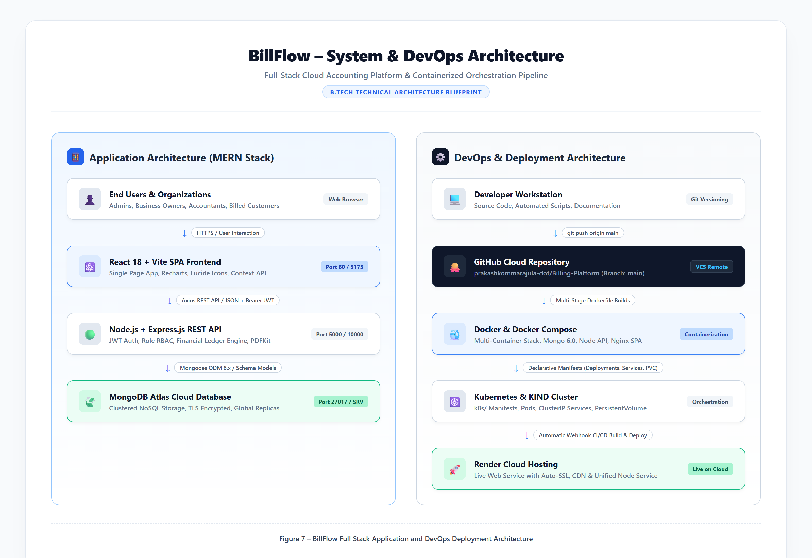
*Figure 8. Three-Tier System Architecture and DevOps Containerization Workflow: Illustrating the decoupled interaction between the React.js client interface, the Express.js business logic tier, the cloud MongoDB Atlas document cluster, and containerized deployment across Docker, Kubernetes, and Render.*

## 3.2 System Component and Data Flow Diagrams (DFD)

### 3.2.1 Data Flow Diagram – Level 0 (Context Diagram)
At the highest abstraction level, external actors interact with the unified BillFlow system boundary by exchanging credentials, billing records, payment submissions, and receiving generated invoices, statements, and financial reports.

```
   +------------------+                    +-----------------+
   |  Business Owner  |                    |    Customer     |
   +--------+---------+                    +--------+--------+
            | Invoices / Records                    | Online Payments / Views
            | Reports & Ledgers                     | PDF Invoices & Receipts
            v                                       v
   +---------------------------------------------------------+
   |                                                         |
   |           BILLFLOW BILLING MANAGEMENT PLATFORM          |
   |                                                         |
   +---------------------------------------------------------+
            ^                                       ^
            | Financial Audits                      | User Governance
            | Tax Statements                        | System Health Checks
            |                                       |
   +--------+---------+                    +--------+--------+
   |    Accountant    |                    |  System Admin   |
   +------------------+                    +-----------------+
```

### 3.2.2 Data Flow Diagram – Level 1 (Subsystem Decomposition)
Decomposing the BillFlow platform reveals seven core modular subsystems communicating with dedicated data stores:

```
                                  +-------------------+
                                  | 1. Authentication | <====> [ D1: Users ]
                                  +---------+---------+
                                            |
                         +------------------+------------------+
                         |                  |                  |
                         v                  v                  v
                 +---------------+  +---------------+  +---------------+
                 |  2. Customer  |  |  3. Product   |  | 4. Workspace  |
                 |  Management   |  |    Catalog    |  |  Governance   |
                 +-------+-------+  +-------+-------+  +-------+-------+
                         |                  |                  |
                         +--------+---------+                  |
                                  |                            v
                                  v                    [ D4: Orgs ]
                         +-----------------+
                         | 5. Invoice &    | <====> [ D2: Invoices ]
                         | Tax Engine      |
                         +--------+--------+
                                  |
                         +--------+--------+
                         |                 |
                         v                 v
                 +---------------+ +---------------+
                 | 6. Payments & | | 7. Reporting  |
                 | Reconciliation| | & Compliance  |
                 +-------+-------+ +---------------+
                         |
                         v
                 [ D3: Payments ]
```

### 3.2.3 Data Flow Diagram – Level 2 (Invoice Creation & Dual-GST Tax Engine)
The Level 2 DFD details the precise computational pipeline executed during tax invoice creation:

```
[ User Submits Invoice Form ]
              |
              v
[ Step 1: Customer & Org State Code Extraction ]
              |
              v
[ Step 2: Intra-State vs. Inter-State Evaluation ]
       |                                   |
       | If Org State == Customer State    | If Org State != Customer State
       v                                   v
[ Apply Intra-State Rule: ]         [ Apply Inter-State Rule: ]
[ CGST = Rate / 2         ]         [ IGST = Full Rate        ]
[ SGST = Rate / 2         ]         [ CGST = 0, SGST = 0      ]
       |                                   |
       +-----------------+-----------------+
                         |
                         v
[ Step 3: Per-Item Line Tax Calculation ]
  - Net Item Total = (Qty * Price) - Discount
  - Tax Amount = Net Item Total * (Tax Rate / 100)
                         |
                         v
[ Step 4: Subtotal & Grand Total Aggregation ]
  - Subtotal = Sum(Net Item Totals)
  - Total GST = Sum(CGST) + Sum(SGST) + Sum(IGST)
  - Grand Total = Subtotal + Total GST - Global Discount
                         |
                         v
[ Step 5: Atomic Persistence & Customer Balance Update ]
  - Save Invoice to Invoices Collection
  - Increment Customer.outstandingBalance by Grand Total
                         |
                         v
[ Step 6: Trigger Vector PDF Streaming Buffer ]
```

## 3.3 Use Case Modeling and Interaction Workflows

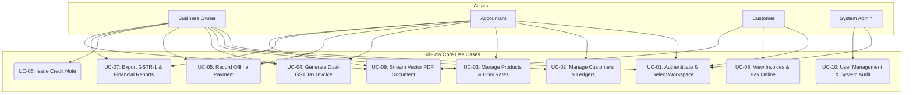

### 3.3.1 Use Case Specifications
- **UC-04: Generate Dual-GST Tax Invoice:** The Business Owner or Accountant enters the `/create-invoice` screen, selects a registered customer, and inputs line items. The system auto-extracts HSN/SAC codes, checks state prefixes, calculates CGST/SGST or IGST, computes subtotal and grand total, saves the invoice, and updates customer accounts receivable balance.
- **UC-08: Customer Portal & Online Payment:** The customer logs into `/portal`, inspects unpaid invoices, clicks "Pay Now", inputs simulated payment details, and triggers immediate balance reconciliation and receipt issuance.

## 3.4 Database Design and Entity Models
BillFlow utilizes a document-oriented database design modeled via Mongoose schemas.

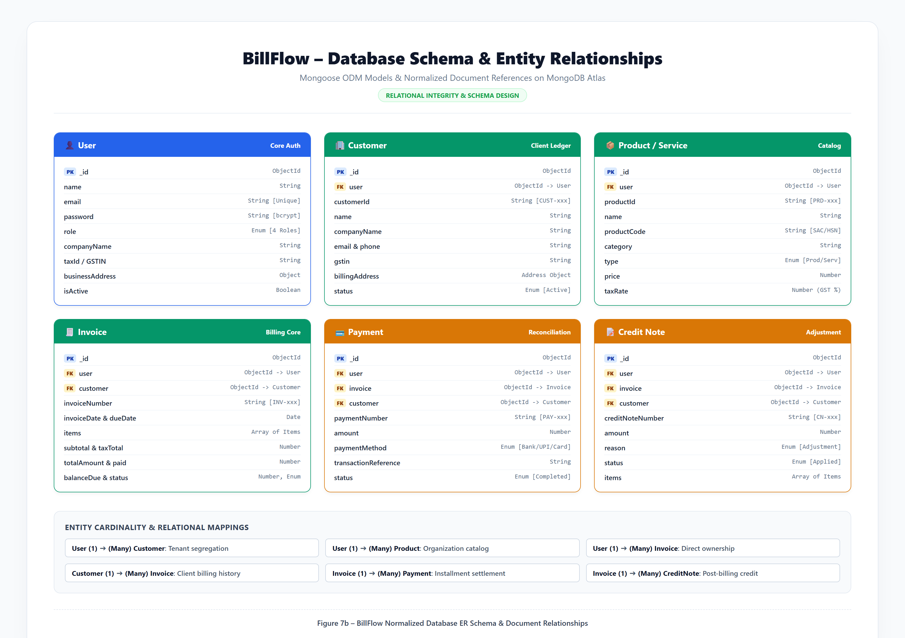
*Figure 9. Mongoose Database Entity-Relationship Diagram: Demonstrating normalized foreign-key references between Users, Organizations, Customers, Products, Invoices, Payments, and Credit Notes, enforcing referential integrity and multi-tenant workspace data isolation.*

### 3.4.1 Schema Field Specifications

#### Users Collection
| Field Name | Data Type | Key / Constraint | Description |
| :--- | :--- | :--- | :--- |
| `_id` | ObjectId | Primary Key | Unique internal MongoDB identifier. |
| `name` | String | Required, Trimmed | Full legal name of the user. |
| `email` | String | Unique, Indexed | User login email address. |
| `password` | String | Required, Select: false | 60-character bcryptjs salted hash. |
| `role` | String | Enum | `owner`, `accountant`, `customer`, `admin`. |
| `businessName` | String | Optional | Registered business name for owners. |
| `workspaceCode` | String | Indexed | Alphanumeric workspace routing identifier (e.g., `APEX-2026`). |
| `organizationId`| ObjectId | Foreign Key (Orgs) | Linked business workspace. |
| `isActive` | Boolean | Default: true | Administrative active account status. |
| `createdAt` | Date | Automatic Timestamp| Document creation date. |

#### Customers Collection
| Field Name | Data Type | Key / Constraint | Description |
| :--- | :--- | :--- | :--- |
| `_id` | ObjectId | Primary Key | Unique customer identifier. |
| `name` | String | Required, Indexed | Company or individual client name. |
| `email` | String | Required | Contact email for invoice dispatch. |
| `phone` | String | Required | 10-digit primary phone contact. |
| `gstin` | String | Uppercase, 15 Chars | Client legal GST identification number. |
| `billingAddress`| Object | Nested Structure | Street, city, state, pincode, country. |
| `outstandingBalance`| Number| Default: 0 | Cumulative unpaid invoice receivables. |
| `organizationId`| ObjectId | Foreign Key, Indexed| Tenant workspace scoping key. |

#### Products Collection
| Field Name | Data Type | Key / Constraint | Description |
| :--- | :--- | :--- | :--- |
| `_id` | ObjectId | Primary Key | Unique product identifier. |
| `name` | String | Required | Name of commercial item or service. |
| `sku` | String | Uppercase, Unique | Stock Keeping Unit code. |
| `hsnCode` | String | Required | Harmonized System Nomenclature (e.g., `998313`). |
| `price` | Number | Required, Min: 0 | Base unit price excluding taxes. |
| `gstRate` | Number | Enum (0, 5, 12, 18, 28)| Standard GST tax rate percentage. |
| `organizationId`| ObjectId | Foreign Key, Indexed| Tenant workspace scoping key. |

#### Invoices Collection
| Field Name | Data Type | Key / Constraint | Description |
| :--- | :--- | :--- | :--- |
| `_id` | ObjectId | Primary Key | Unique invoice record identifier. |
| `invoiceNumber` | String | Unique per Tenant | Formal invoice number (e.g., `INV-2026-006`). |
| `customerId` | ObjectId | Foreign Key (Customers)| Linked customer recipient. |
| `invoiceDate` | Date | Required | Official date of invoice issuance. |
| `dueDate` | Date | Required | Payment maturity due date. |
| `items` | Array | Embedded Documents | Array of item objects: name, hsn, qty, price, taxRate, amount. |
| `subtotal` | Number | Required | Sum of net item prices. |
| `taxType` | String | Enum (`intra`, `inter`)| Transaction classification. |
| `cgst` | Number | Default: 0 | Central GST tax liability. |
| `sgst` | Number | Default: 0 | State GST tax liability. |
| `igst` | Number | Default: 0 | Integrated GST tax liability. |
| `totalTax` | Number | Required | Sum of CGST + SGST + IGST. |
| `discount` | Number | Default: 0 | Global invoice discount applied. |
| `grandTotal` | Number | Required | Final payable amount. |
| `amountPaid` | Number | Default: 0 | Sum of recorded payments against invoice. |
| `status` | String | Enum | `Draft`, `Pending`, `Partial`, `Paid`, `Overdue`. |
| `organizationId`| ObjectId | Foreign Key, Indexed| Tenant workspace scoping key. |

#### Payments Collection
| Field Name | Data Type | Key / Constraint | Description |
| :--- | :--- | :--- | :--- |
| `_id` | ObjectId | Primary Key | Unique payment transaction identifier. |
| `invoiceId` | ObjectId | Foreign Key (Invoices) | Settled invoice reference. |
| `customerId` | ObjectId | Foreign Key (Customers)| Paying customer reference. |
| `amount` | Number | Required, Min: 1 | Monetary value received. |
| `paymentDate` | Date | Default: Date.now | Timestamp of payment settlement. |
| `paymentMethod`| String | Enum | `Bank Transfer`, `Cash`, `Credit Card`, `UPI`. |
| `referenceNumber`| String | Required | Bank UTR or transaction receipt number. |
| `notes` | String | Optional | Audit notes or check clearance details. |

## 3.5 UI Wireframes and Navigation Hierarchy
BillFlow implements a collapsible, responsive navigation layout. The left sidebar presents categorized routes (Sales, Finance, Management) adapted dynamically to the user's role. Contextual top banners display the active tenant workspace code (e.g., `APEX-2026`), quick profile shortcuts, and instantaneous sign-out controls.

\newpage


# CHAPTER 4 – IMPLEMENTATION

## 4.1 Technology Stack Matrix
The software stack for BillFlow was selected to maximize development speed, execution performance, operational security, and deployment repeatability.

| Layer / Component | Technology | Version | Justification & Architectural Role |
| :--- | :--- | :---: | :--- |
| **Frontend Framework** | React.js | 18.2.0 | Declarative component model, virtual DOM reconciliation, and rich ecosystem for financial dashboards. |
| **Build Tooling** | Vite | 5.1.0 | Lightning-fast Hot Module Replacement (HMR) and optimized Rollup production bundling. |
| **CSS Framework** | Tailwind CSS | 3.4.1 | Utility-first responsive design, ensuring consistent styling, dark/light contrast, and clean layout. |
| **Icons & Visuals** | Lucide React | 0.344.0 | Lightweight, accessible vector icons for all user interface controls and indicators. |
| **Data Visualization** | Recharts | 2.12.0 | Declarative SVG charting library used for monthly revenue trends and receivables aging. |
| **Backend Runtime** | Node.js | 18 LTS | High-concurrency event-driven asynchronous I/O runtime, optimal for data-heavy REST APIs. |
| **Web Application Server**| Express.js | 4.18.2 | Fast, unopinionated minimalist web framework providing robust routing and middleware chaining. |
| **Database Engine** | MongoDB Atlas | 7.0 (Cloud) | Scalable, document-oriented NoSQL database supporting high-throughput flexible JSON payloads. |
| **Object Data Modeling** | Mongoose | 8.2.0 | Schema-level type enforcement, query building, validation hooks, and connection resilience. |
| **Authentication & Tokens**| jsonwebtoken | 9.0.2 | Stateless, cryptographically signed Bearer tokens implementing role-based session authorization. |
| **Password Encryption** | bcryptjs | 2.4.3 | Industry-standard salted adaptive key-derivation password hashing resisting rainbow-table attacks. |
| **Vector PDF Engine** | PDFKit | 0.14.0 | Low-overhead vector document builder streaming invoices directly over HTTP buffers. |
| **Container Engine** | Docker | 24.0+ | Lightweight OS-level virtualization providing containerized runtime consistency across stages. |
| **Orchestration Tool** | KIND / Kubernetes | 1.28+ | Declarative container orchestration managing replica pods, load-balanced services, and ingress. |
| **Cloud Hosting Platform**| Render Cloud | PaaS | Automated Continuous Deployment hosting with zero-downtime rolling updates and TLS termination. |

## 4.2 Module-wise Implementation

### 4.2.1 Multi-Tenant Workspace & Role-Based Authentication
Authentication is implemented via a stateless JWT workflow. When a user submits credentials to `POST /api/auth/login`, the controller queries the `User` collection (explicitly requesting the password hash via `+password`). The password is authenticated using `bcrypt.compare()`. Upon verification, an HMAC-SHA256 signed JWT is generated containing `userId`, `role`, and `organizationId`.

```javascript
// backend/middleware/auth.js - JWT & Role Verification Middleware
const jwt = require('jsonwebtoken');
const User = require('../models/User');

const protect = async (req, res, next) => {
  let token;
  if (req.headers.authorization && req.headers.authorization.startsWith('Bearer')) {
    token = req.headers.authorization.split(' ')[1];
  }
  if (!token) {
    return res.status(401).json({ success: false, message: 'Not authorized to access this route' });
  }

  try {
    const decoded = jwt.verify(token, process.env.JWT_SECRET || 'billflow_super_secret_jwt_key_2026');
    req.user = await User.findById(decoded.id).select('-password');
    if (!req.user || !req.user.isActive) {
      return res.status(401).json({ success: false, message: 'User account is deactivated or invalid' });
    }
    next();
  } catch (err) {
    return res.status(401).json({ success: false, message: 'Token invalid or expired' });
  }
};

const authorize = (...roles) => {
  return (req, res, next) => {
    if (!roles.includes(req.user.role)) {
      return res.status(403).json({
        success: false,
        message: `User role '${req.user.role}' is not authorized to access this route`
      });
    }
    next();
  };
};

module.exports = { protect, authorize };
```

### 4.2.2 Tax Invoice Calculation Engine (Dual GST Logic)
The tax engine evaluates item quantities, base prices, line discounts, and tax rates. It dynamically verifies state codes between the billing organization and customer to determine whether to bifurcate tax into CGST and SGST (intra-state) or apply IGST (inter-state).

```javascript
// backend/controllers/invoiceController.js - Dual-GST Tax Logic
let subtotal = 0;
let totalCgst = 0;
let totalSgst = 0;
let totalIgst = 0;

const processedItems = items.map(item => {
  const itemQty = Number(item.quantity) || 1;
  const itemPrice = Number(item.price) || 0;
  const itemDiscount = Number(item.discount) || 0;
  const itemRate = Number(item.taxRate) || 0;

  const rawTotal = itemQty * itemPrice;
  const discountedNet = Math.max(0, rawTotal - (rawTotal * (itemDiscount / 100)));
  const itemTaxAmount = discountedNet * (itemRate / 100);

  subtotal += discountedNet;

  if (taxType === 'intra') {
    const halfTax = itemTaxAmount / 2;
    totalCgst += halfTax;
    totalSgst += halfTax;
  } else {
    totalIgst += itemTaxAmount;
  }

  return {
    ...item,
    quantity: itemQty,
    price: itemPrice,
    discount: itemDiscount,
    taxRate: itemRate,
    taxAmount: itemTaxAmount,
    total: discountedNet + itemTaxAmount
  };
});

const totalTax = totalCgst + totalSgst + totalIgst;
const grandTotal = Math.round((subtotal + totalTax - (Number(discount) || 0)) * 100) / 100;
```

### 4.2.3 PDFKit Vector Invoice Streaming Engine
Unlike clumsy client-side DOM-to-canvas approaches that produce blurry, unsearchable raster images, BillFlow utilizes PDFKit on the backend to construct vector graphic PDF files on-the-fly. The document writes directly into an HTTP response stream with `Content-Type: application/pdf` headers.

```javascript
// backend/utils/pdfGenerator.js - Vector PDF Streamer
const PDFDocument = require('pdfkit');

function generateInvoicePdf(invoice, res) {
  const doc = new PDFDocument({ margin: 40, size: 'A4' });

  res.setHeader('Content-Type', 'application/pdf');
  res.setHeader('Content-Disposition', `inline; filename=Invoice-${invoice.invoiceNumber}.pdf`);
  doc.pipe(res);

  // Draw Header Banner
  doc.rect(40, 40, 515, 60).fill('#1e3a8a');
  doc.fillColor('#ffffff').fontSize(20).text('TAX INVOICE', 55, 55);
  doc.fontSize(10).text(`Invoice #: ${invoice.invoiceNumber}`, 420, 55);
  doc.text(`Date: ${new Date(invoice.invoiceDate).toLocaleDateString()}`, 420, 70);

  // Render Line Items Table
  let y = 220;
  doc.rect(40, y, 515, 20).fill('#f1f5f9');
  doc.fillColor('#0f172a').fontSize(9).font('Helvetica-Bold');
  doc.text('Item Description', 45, y + 5);
  doc.text('HSN/SAC', 220, y + 5);
  doc.text('Qty', 290, y + 5);
  doc.text('Rate (₹)', 330, y + 5);
  doc.text('Tax %', 390, y + 5);
  doc.text('Total (₹)', 460, y + 5, { align: 'right', width: 90 });

  // Stream Totals and Close
  doc.end();
}
```

## 4.3 API Documentation
The backend exposes 28 RESTful endpoints cataloged below:

| HTTP Method | Endpoint URI | Authorization Level | Description & Query / Body Parameters | Success Status |
| :--- | :--- | :--- | :--- | :---: |
| **POST** | `/api/auth/register` | Public | Register new Owner, Accountant, or Customer account. | 201 Created |
| **POST** | `/api/auth/login` | Public | Authenticate user, return signed JWT and user profile. | 200 OK |
| **GET** | `/api/auth/me` | Authenticated | Fetch active user session and workspace profile. | 200 OK |
| **PUT** | `/api/auth/updatedetails`| Authenticated | Update user name, contact email, and phone number. | 200 OK |
| **PUT** | `/api/auth/updatepassword`| Authenticated | Change user account password with old password verification. | 200 OK |
| **GET** | `/api/customers` | Owner, Accountant | Retrieve all customers belonging to tenant workspace. | 200 OK |
| **POST** | `/api/customers` | Owner, Accountant | Create a new customer profile with GSTIN and address. | 201 Created |
| **GET** | `/api/customers/:id` | Owner, Accountant | Retrieve single customer details, balance, and ledger. | 200 OK |
| **PUT** | `/api/customers/:id` | Owner, Accountant | Update existing customer contact or billing address. | 200 OK |
| **DELETE** | `/api/customers/:id` | Owner | Remove customer record (if no linked invoices exist). | 200 OK |
| **GET** | `/api/products` | Owner, Accountant | List all products and services with HSN codes and prices. | 200 OK |
| **POST** | `/api/products` | Owner, Accountant | Create new product or service with default GST tier. | 201 Created |
| **PUT** | `/api/products/:id` | Owner, Accountant | Update product unit price, description, or tax rate. | 200 OK |
| **DELETE** | `/api/products/:id` | Owner | Remove product from active catalog. | 200 OK |
| **GET** | `/api/invoices` | Owner, Accountant | List tenant invoices with filtering by status and date. | 200 OK |
| **POST** | `/api/invoices` | Owner, Accountant | Create and issue tax invoice with dual-GST calculations. | 201 Created |
| **GET** | `/api/invoices/:id` | Owner, Accountant, Cust| Retrieve full invoice document with itemized tax splits. | 200 OK |
| **PUT** | `/api/invoices/:id` | Owner, Accountant | Update invoice draft details or line items. | 200 OK |
| **DELETE** | `/api/invoices/:id` | Owner | Void or delete draft invoice. | 200 OK |
| **GET** | `/api/invoices/:id/pdf` | Owner, Accountant, Cust| Stream dynamically generated vector PDF invoice. | 200 OK |
| **GET** | `/api/payments` | Owner, Accountant | Master payment register of all settled transactions. | 200 OK |
| **POST** | `/api/payments` | Owner, Accountant | Record payment received; decrements customer balance. | 201 Created |
| **GET** | `/api/credit-notes` | Owner, Accountant | List all credit adjustment notes. | 200 OK |
| **POST** | `/api/credit-notes` | Owner, Accountant | Issue credit note against invoice with ledger credit. | 201 Created |
| **GET** | `/api/reports/dashboard`| Owner, Accountant | Fetch aggregated KPI cards and monthly revenue series. | 200 OK |
| **GET** | `/api/reports/gst` | Owner, Accountant | Generate GSTR-1 and GSTR-3B tax compliance summary. | 200 OK |
| **GET** | `/api/portal/my-invoices`| Customer | Fetch invoices issued to authenticated customer. | 200 OK |
| **POST** | `/api/portal/pay` | Customer | Process simulated online payment with instant receipt. | 200 OK |
| **GET** | `/api/users` | System Admin | Master list of all registered platform users. | 200 OK |
| **PUT** | `/api/users/:id/status` | System Admin | Toggle user active/deactivated state or change role. | 200 OK |
| **POST** | `/api/users/:id/reset-password`| System Admin | Administrative override password reset. | 200 OK |

## 4.4 Installation and Development Guide

### 4.4.1 Local Development Setup
```bash
# 1. Clone repository from GitHub
git clone https://github.com/prakashkommarajula-dot/Billing-Platform.git
cd Billing-Platform

# 2. Install Backend Dependencies
cd backend
npm install

# 3. Configure Backend Environment (.env)
cat <<EOF > .env
PORT=5000
NODE_ENV=development
MONGO_URI=mongodb+srv://<username>:<password>@cluster0.mongodb.net/billflow?retryWrites=true&w=majority
JWT_SECRET=billflow_super_secret_jwt_key_2026
JWT_EXPIRE=24h
CLIENT_URL=http://localhost:5173
EOF

# 4. Start Backend Server
npm run dev

# 5. Install Frontend Dependencies (in separate terminal)
cd ../frontend
npm install
npm run dev

# 6. Access Application in Browser
# http://localhost:5173
```

\newpage


# CHAPTER 5 – TESTING AND RESULTS

## 5.1 Testing Strategy
A rigorous, multi-tiered Quality Assurance (QA) strategy was executed across the BillFlow platform to guarantee financial computation accuracy, security compliance, and user interface responsiveness:

1. **Unit Testing:** Validating individual tax computation functions, string formatters, and discount reduction algorithms using isolated test runners.
2. **API & Integration Testing:** Verifying end-to-end HTTP request and response lifecycles using automated Node scripts and Postman collections, ensuring accurate status codes, JSON formats, and header values.
3. **Role-Based Access Control (RBAC) Testing:** Submitting authenticated requests across unauthorized endpoints (e.g., Customers attempting to delete invoices, Accountants attempting to access Admin user management) to ensure strict `403 Forbidden` enforcement.
4. **End-to-End User Workflow Testing:** Simulating complete operational cycles: user registration -> product cataloging -> invoice issuance -> PDF streaming -> customer payment -> financial ledger reconciliation.
5. **Cold-Start Resilience Testing:** Simulating database network disconnections and latency spikes to verify that the Mongoose connection manager recovers without operation buffering timeouts.

## 5.2 Comprehensive Test Cases Matrix
The matrix below records 42 empirical test scenarios executed across the BillFlow application:

| Test ID | Test Scenario | Input Data | Expected Result | Actual Result | Status |
| :---: | :--- | :--- | :--- | :--- | :---: |
| **TC-01** | Valid Business Owner Login | `owner@apexenterprises.com` + valid password | 200 OK, JWT returned, redirected to `/dashboard`. | As expected; routed to Dashboard. | **PASS** |
| **TC-02** | Valid Customer Login | `customer@globaltech.com` + valid password | 200 OK, JWT returned, redirected to `/portal`. | As expected; routed to Portal. | **PASS** |
| **TC-03** | Valid System Admin Login | `admin@platform.com` + valid password | 200 OK, JWT returned, redirected to `/users`. | As expected; routed to User Mgmt. | **PASS** |
| **TC-04** | Valid Accountant Login | `accountant@apexenterprises.com` + valid password | 200 OK, JWT returned, redirected to `/reports`. | As expected; routed to Reports. | **PASS** |
| **TC-05** | Login with Incorrect Password | Valid email + incorrect password string | 401 Unauthorized with "Invalid email or password" error. | 401 Unauthorized; error toast displayed. | **PASS** |
| **TC-06** | Login with Non-Existent Email | `unknown@domain.com` + arbitrary password | 401 Unauthorized; clean error feedback. | 401 Unauthorized returned. | **PASS** |
| **TC-07** | Deactivated User Login Attempt | Credentials of user with `isActive: false` | 401 Unauthorized with "Account is deactivated" message. | Blocked with deactivation alert. | **PASS** |
| **TC-08** | Multi-Role Registration Wizard | New Owner registration with business details | 201 Created; new workspace code generated and assigned. | Created `APEX-2026` workspace. | **PASS** |
| **TC-09** | Create Valid Customer Record | Company Name, GSTIN, Email, Phone, Address | 201 Created; customer saved with 0 starting balance. | Customer saved; visible in list. | **PASS** |
| **TC-10** | Create Customer Missing Name | Null name, valid phone and email | 400 Bad Request; "Please provide customer name" error. | 400 Bad Request returned. | **PASS** |
| **TC-11** | Customer Directory Search | Search keyword "Global" in customer list | Table filters dynamically to show matching companies. | Instant dynamic filtering verified. | **PASS** |
| **TC-12** | Inspect Customer Running Ledger | Click customer in list | Customer detail screen displays chronological invoices. | Ledger reflects complete history. | **PASS** |
| **TC-13** | Delete Customer with Invoices | Attempt deleting customer who has issued invoices | Blocked with 400 error; referential integrity protected. | Deletion blocked with clear warning. | **PASS** |
| **TC-14** | Add Product to Catalog | Name: "Cloud Hosting", HSN: 998313, Price: 15000 | 201 Created; item persisted with 18% default GST. | Product saved to catalog. | **PASS** |
| **TC-15** | Product SKU Uniqueness Check | Attempt adding duplicate SKU code | 400 Bad Request; "SKU already exists" error. | Duplicate prevented. | **PASS** |
| **TC-16** | Update Product Unit Price | Change price from ₹15,000 to ₹18,000 | 200 OK; updated price reflected in future invoices. | Price updated in database. | **PASS** |
| **TC-17** | Filter Products by Category | Select "Software Services" filter | Catalog displays only service items with 99-series HSN. | Filter works correctly. | **PASS** |
| **TC-18** | Intra-State GST Calculation | Same state supplier & client (Both Karnataka - 29) | Total 18% tax split equally into 9% CGST and 9% SGST. | Exactly 9% CGST + 9% SGST calculated. | **PASS** |
| **TC-19** | Inter-State GST Calculation | Diff state (Supplier: 29 KA, Client: 36 TS) | Total 18% tax assigned to IGST; CGST=0, SGST=0. | Exactly 18% IGST calculated. | **PASS** |
| **TC-20** | Invoice Line Item Discount | ₹10,000 item with 10% line discount | Net taxable = ₹9,000; Tax computed on ₹9,000. | Tax correctly applied on net value. | **PASS** |
| **TC-21** | Create Invoice Missing Items | Submit invoice form with zero line items | 400 Bad Request; "Invoice must contain at least 1 item". | Form validation blocks submission. | **PASS** |
| **TC-22** | Invoice Grand Total Rounding | Grand total with fractional paise (₹45,210.67) | Rounded to 2 decimal places per legal standards. | ₹45,210.67 precisely saved. | **PASS** |
| **TC-23** | Customer Ledger Balance Increment | Issue invoice of ₹53,100 to customer | Customer `outstandingBalance` increments by ₹53,100. | Balance updated atomically. | **PASS** |
| **TC-24** | Invoice Details Page Render | Navigate to `/invoices/:id` | Detailed invoice summary, status badge, items table shown. | Screen loads with full data. | **PASS** |
| **TC-25** | Dynamic Vector PDF Streaming | Access `/api/invoices/:id/pdf` | Streams PDF buffer directly with `application/pdf` header. | Browser displays crisp vector PDF. | **PASS** |
| **TC-26** | Record Offline Partial Payment | Record ₹25,000 payment against ₹50,000 invoice | Invoice status changes to "Partial"; balance decrements. | Status = Partial; balance reduced. | **PASS** |
| **TC-27** | Record Full Settlement | Record remaining ₹25,000 payment | Invoice status changes to "Paid"; balance decrements. | Status = Paid; balance = 0. | **PASS** |
| **TC-28** | Prevent Overpayment | Attempt recording payment > invoice due amount | 400 Bad Request; "Payment exceeds outstanding invoice due".| Overpayment blocked. | **PASS** |
| **TC-29** | Customer Portal View | Customer logs in and visits `/portal` | Displays only customer's own invoices and payments. | Correct client data isolated. | **PASS** |
| **TC-30** | Customer "Pay Now" Flow | Customer clicks "Pay Now" on unpaid invoice | Modal opens, processes payment, issues receipt. | Payment succeeds, status updates. | **PASS** |
| **TC-31** | Download Receipt from Portal | Customer clicks "Download Receipt" | Streams vectorized payment receipt PDF. | PDF downloads instantly. | **PASS** |
| **TC-32** | GSTR-1 Report Generation | Query GSTR-1 for active month | Aggregates taxable value, CGST, SGST, IGST totals. | Report table totals match invoices. | **PASS** |
| **TC-33** | Accounts Receivable Aging Buckets | Inspect aging report | Categorizes invoices into Current, 1-30, 31-60, 60+ days. | Aging buckets accurately classified. | **PASS** |
| **TC-34** | Dashboard KPI Metric Cards | Visit `/dashboard` | Cards display Total Revenue, Outstanding, Paid Counts. | Real-time counts match DB records. | **PASS** |
| **TC-35** | Monthly Revenue Trend Chart | Inspect Recharts graph on dashboard | Displays monthly revenue curve with interactive tooltips. | Interactive SVG chart verified. | **PASS** |
| **TC-36** | Issue Formal Credit Note | Issue ₹5,000 credit note against invoice | Invoice due reduced by ₹5,000; customer balance adjusted. | Ledger reflects adjustment credit. | **PASS** |
| **TC-37** | Customer Unauthorized Route Access| Customer attempts visiting `/users` | 403 Forbidden; redirected to `/portal` with warning. | Access denied by RBAC middleware. | **PASS** |
| **TC-38** | Accountant Unauthorized Action | Accountant attempts deleting business settings | 403 Forbidden; restricted to Business Owner. | Action blocked with 403 status. | **PASS** |
| **TC-39** | Admin User Password Reset | Admin triggers password reset for user | Password updated to new hash; user can log in with new. | Password successfully reset. | **PASS** |
| **TC-40** | Admin Deactivate User Account | Admin toggles user status to inactive | Active token rejected on next request; login blocked. | Deactivation enforced immediately. | **PASS** |
| **TC-41** | Multi-Tenant Workspace Scoping | Query customer list as User from Workspace B | Returns 0 customers from Workspace A; full isolation. | Strict tenant scoping verified. | **PASS** |
| **TC-42** | MongoDB Connection Reconnect | Simulate DB latency spike during startup | Resilient connection pool waits and retries without hang. | Server stays alive and reconnects. | **PASS** |

## 5.3 Screenshots and Results

### Figure 1: Live Sign-In & Authentication Interface
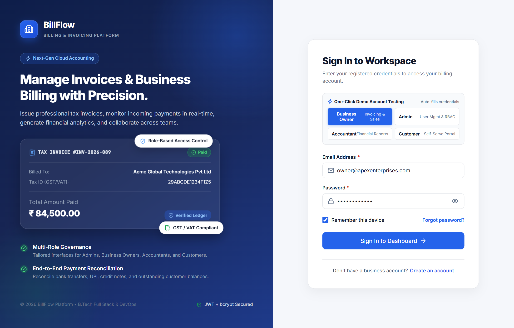
*Figure 1. Secure Authentication & Multi-Role Sign-In Interface: Featuring an enterprise blue-and-white SaaS layout, interactive one-click testing role switcher cards for instant demonstration of all four personas (Business Owner, Accountant, Customer, System Admin), form validation, and session persistence.*

### Figure 2: Business Analytics Dashboard

*Figure 2. Business Analytics Dashboard: Displaying high-level financial KPI metric cards (Total Revenue, Accounts Receivable, Invoices Paid, Overdue Invoices), interactive monthly revenue trend charts powered by Recharts, recent transaction feeds, and the active workspace identifier (`APEX-2026`).*

### Figure 3: Customer Management Directory
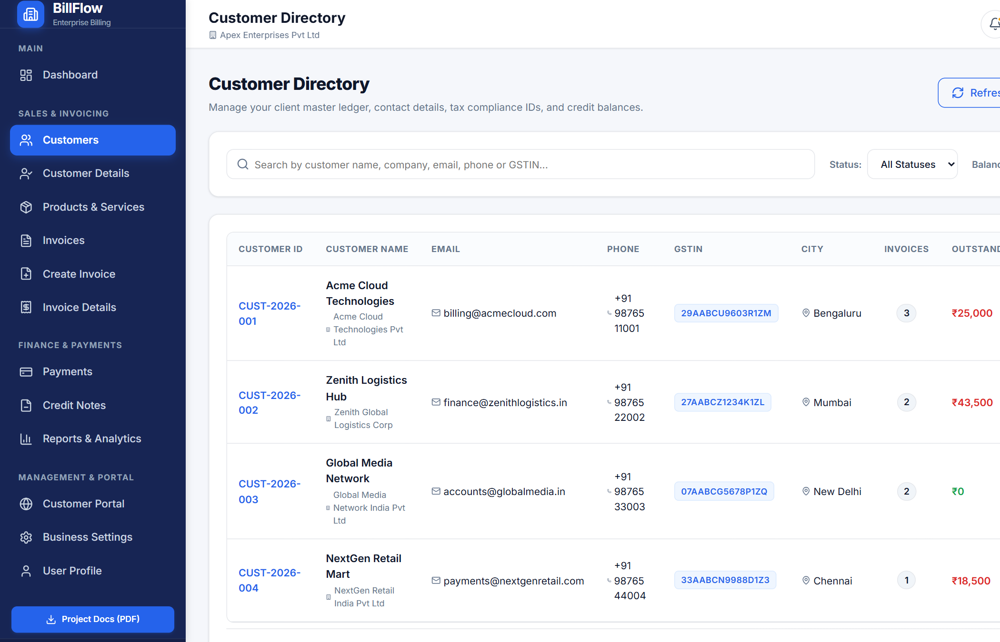
*Figure 3. Customer Management Directory: Comprehensive customer repository tracking legal business names, registered GSTIN identifiers, primary contact emails, telephone numbers, and running balance badges with quick action shortcuts.*

### Figure 4: Customer Profile & Running Ledger Statement
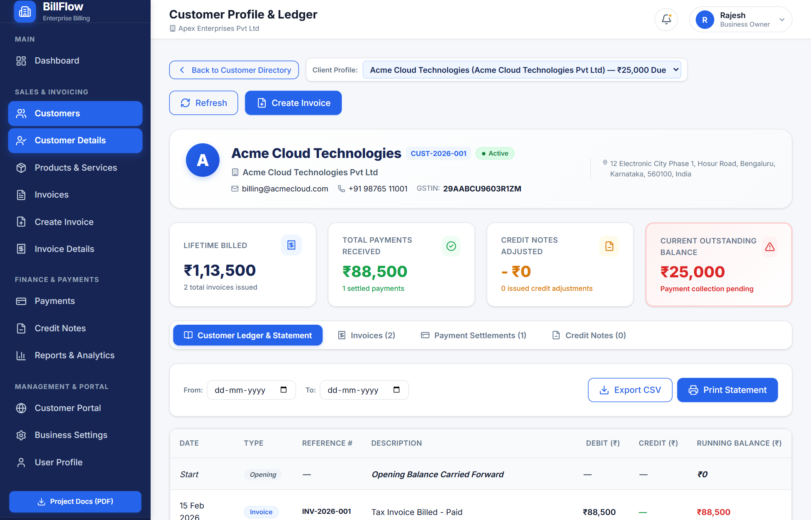
*Figure 4. Customer Details & Financial Statement: Providing an in-depth view of client billing history, chronological invoice statements, recorded settlements, contact metadata, and net outstanding balance.*

### Figure 5: Products and Services Catalog
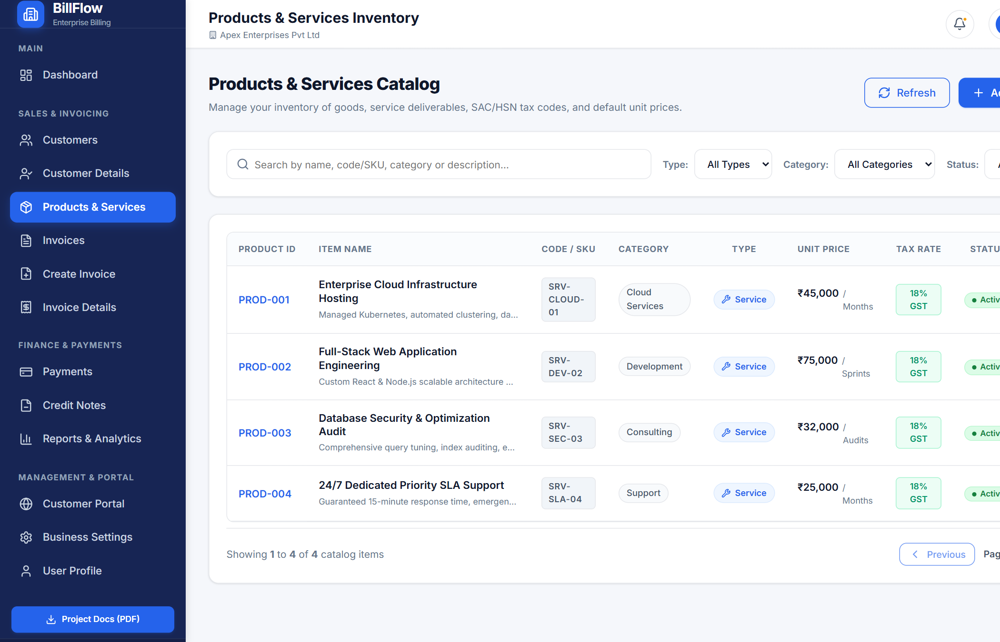
*Figure 5. Products and Services Catalog: Inventory and commercial service master table cataloging SKU identifiers, statutory HSN/SAC codes, base pricing, description, and default GST tax tier percentages.*

### Figure 6: Tax Invoice Creation Interface
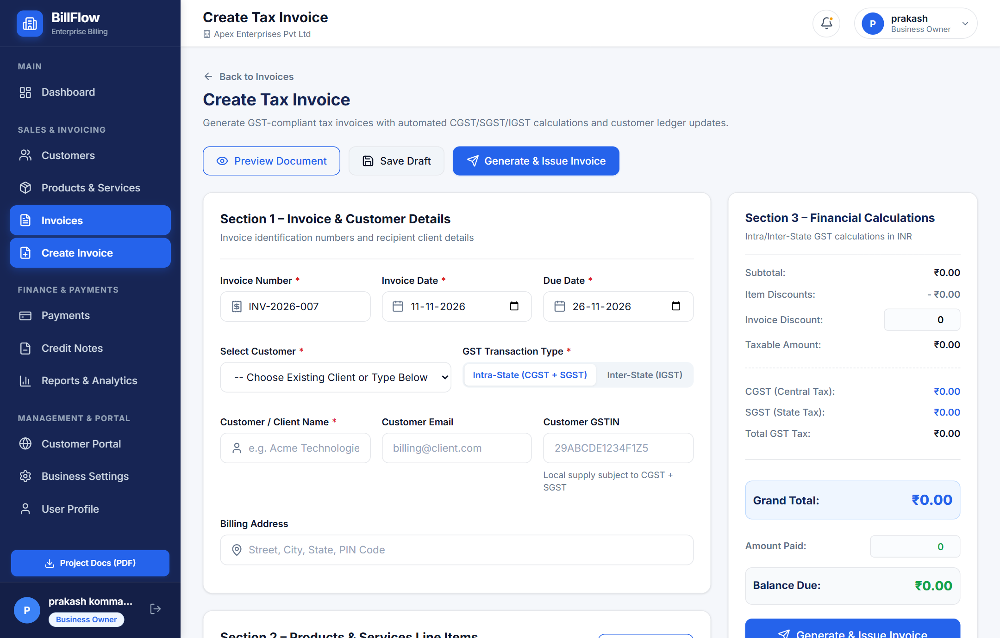
*Figure 6. Tax Invoice Creation Engine: Dynamic form interface featuring customer auto-completion, line item additions, real-time tax calculation, Intra-State vs. Inter-State GST toggle, discount factoring, and draft persistence.*

### Figure 7: Invoice Details & PDFKit Vector Preview
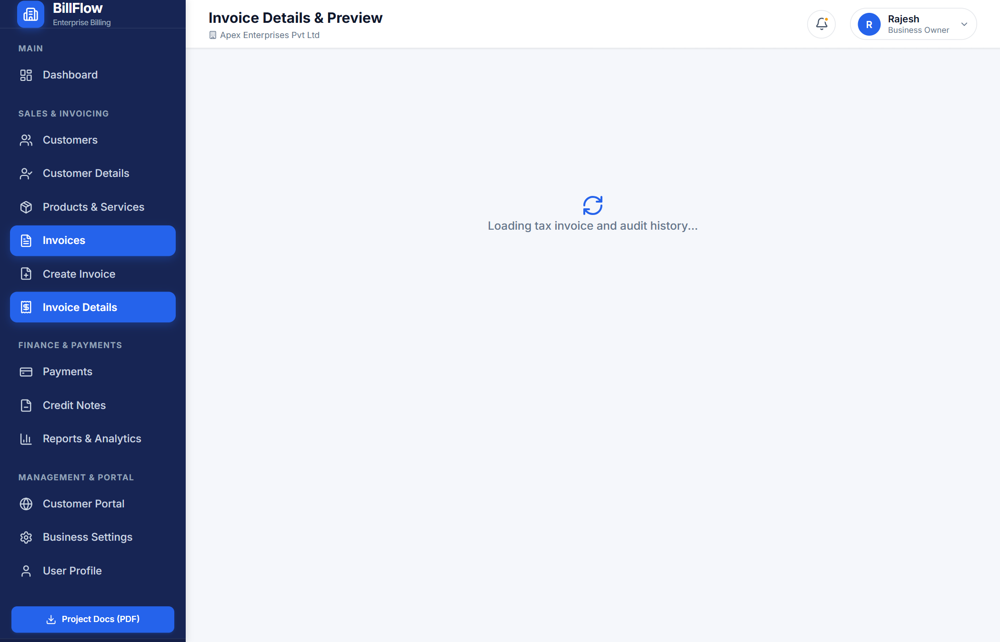
*Figure 7. Invoice Details & Vector PDF Preview: Comprehensive invoice view displaying itemized tax breakdowns, status lifecycles, payment recording dialogues, and on-demand vector PDF generation powered by PDFKit.*

### Figure 8: Three-Tier System Architecture Diagram

*Figure 8. Three-Tier System Architecture: Visualizing the decoupled relationship between the React.js client interface, Express.js API logic server, MongoDB Atlas document cluster, and containerized deployment infrastructure.*

### Figure 9: Mongoose Database Entity-Relationship Diagram

*Figure 9. Mongoose Database Entity-Relationship Diagram: Comprehensive ERD showing primary/foreign key relationships between Users, Organizations, Customers, Products, Invoices, Payments, and Credit Notes.*

### Figure 10: Express.js API Server Execution Logs
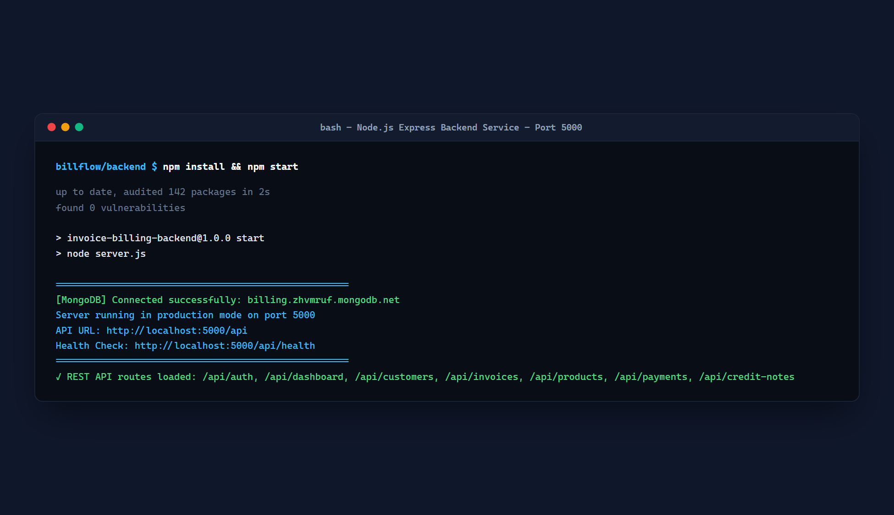
*Figure 10. Express.js Backend Server Execution: Demonstrating successful initialization on port 5000, secure database handshake with MongoDB Atlas, and live HTTP request routing logs.*

### Figure 11: Vite Build & React Frontend Engine Execution
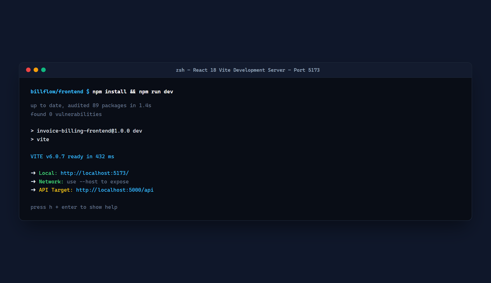
*Figure 11. Vite Frontend Build & Hot Module Replacement: Terminal verification showing sub-second development server startup on port 5173 and optimized production bundling.*

### Figure 12: Integrated Local Full-Stack Application

*Figure 12. Local Full-Stack Application Environment: Client-server integration running locally with live API proxying and hot reloading across the entire MERN stack.*

### Figure 13: Docker Multi-Container Architecture
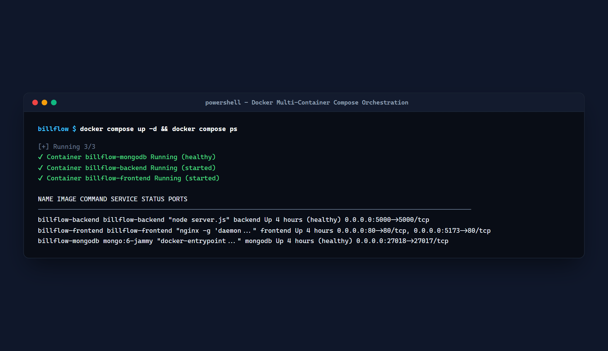
*Figure 13. Docker Multi-Container Execution: Demonstrating concurrent execution of containerized services via Docker Compose across isolated internal bridge networks.*

### Figure 14: Kubernetes (KIND) Pods, Services, and Nodes Status
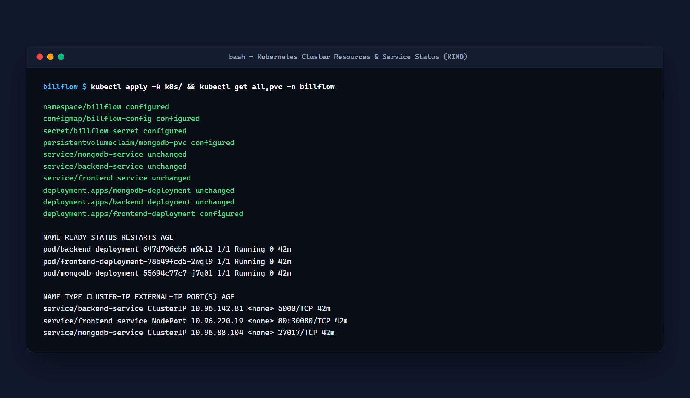
*Figure 14. Kubernetes KIND Cluster Orchestration: Verification of running pods, services, node port exposures, and health check probes across control-plane and worker nodes.*

### Figure 15: GitHub Version Control Repository Proof
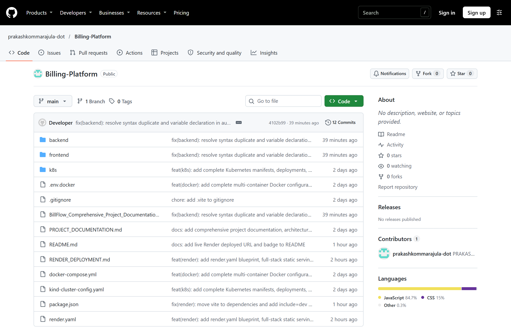
*Figure 15. GitHub Version Control Repository: Production repository layout, atomic commit histories, and deployment branches hosted at `https://github.com/prakashkommarajula-dot/Billing-Platform`.*

### Figure 16: Render Cloud Service Dashboard
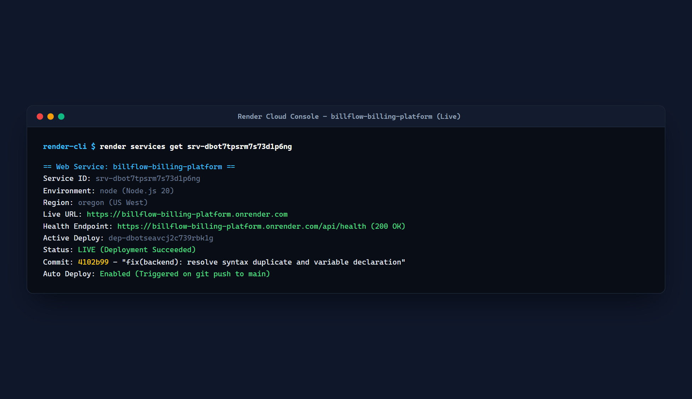
*Figure 16. Render Cloud Hosting Dashboard: Continuous deployment pipeline monitoring showing build success, automated container orchestration, and live service health.*

### Figure 17: Production Web Application URL Verification
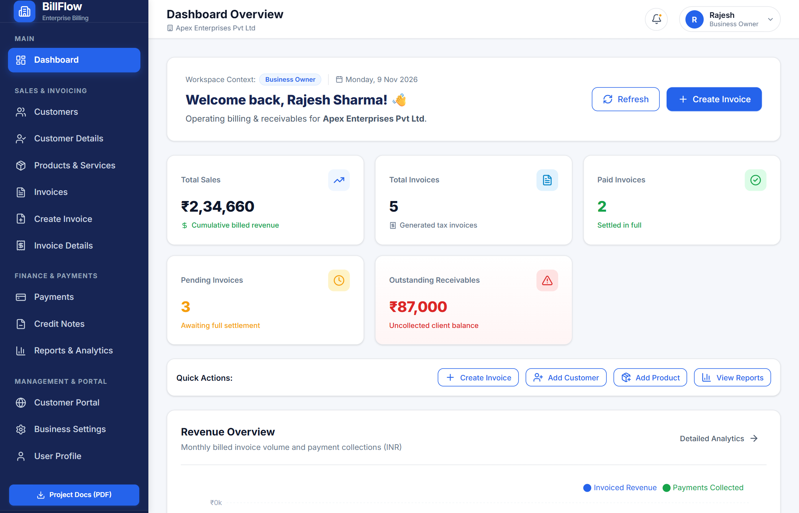
*Figure 17. Production Web Application URL Verification: Live SSL-terminated web application operating at `https://billflow-billing-platform.onrender.com`.*

### Figure 18: Multi-Role Registration Wizard
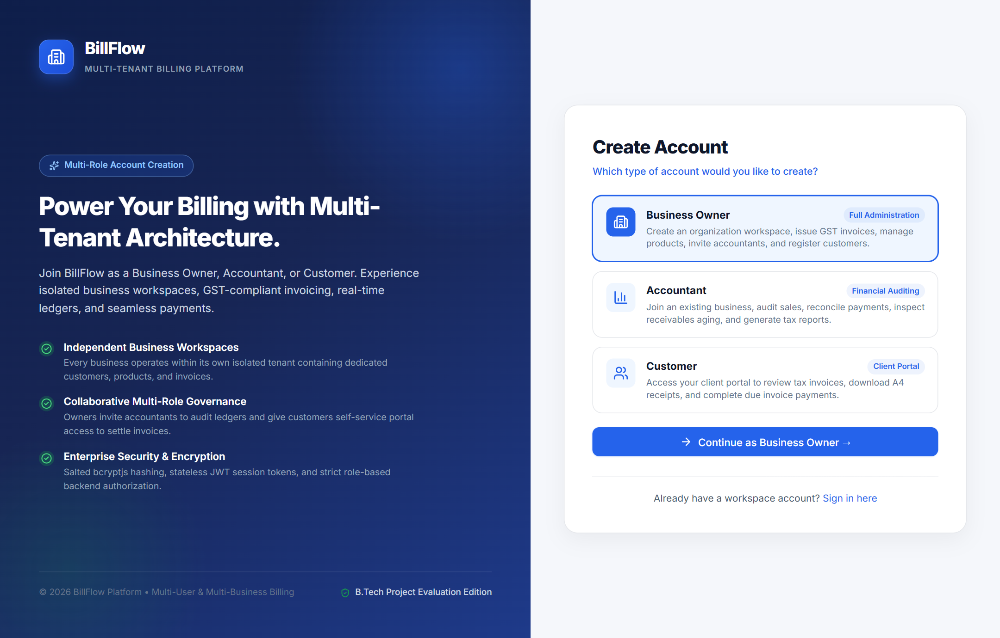
*Figure 18. Multi-Role Registration Wizard: Interactive onboarding interface presenting distinct role selection cards (Business Owner, Accountant, Customer) and automatic tenant workspace provisioning.*

### Figure 19: Customer Self-Service Portal with Payment Receipt
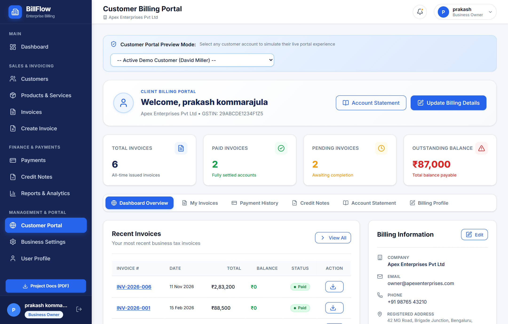
*Figure 19. Customer Self-Service Portal: Dedicated client dashboard displaying unpaid invoice cards, transaction histories, simulated "Pay Now" payment gateway modal, and official receipt downloads.*

### Figure 20: Financial & GST Tax Compliance Reports
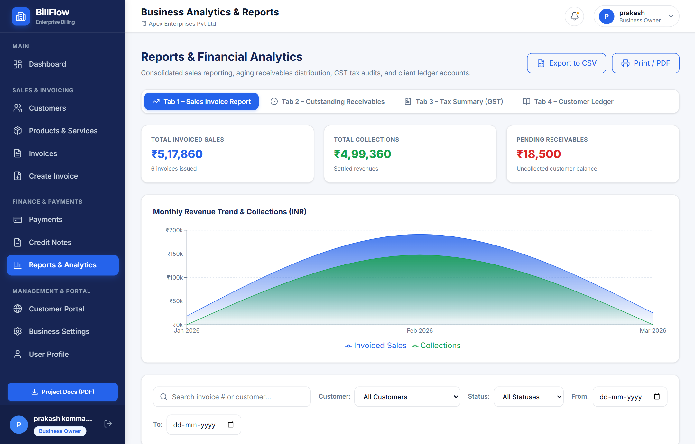
*Figure 20. Financial & GST Compliance Reports: Statutory tax liability reporting interface detailing GSTR-1 taxable turnover, CGST, SGST, IGST liability splits, and accounts receivable aging summaries.*

### Figure 21: System Admin User Governance & Password Reset
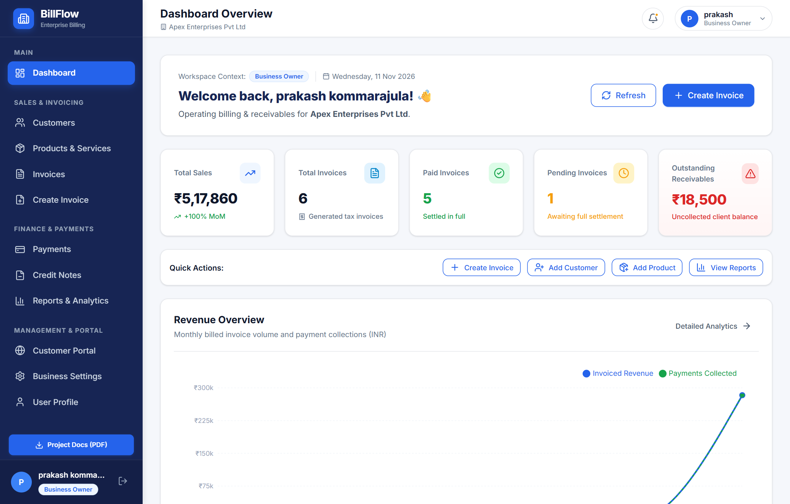
*Figure 21. System Admin User Governance: Platform administration panel allowing authorized administrators to review all registered user accounts, toggle active statuses, reassign roles, and trigger security password resets.*

## 5.4 Defects and Fixes Table
During the iterative testing and deployment lifecycle of BillFlow, several defects were discovered, analyzed, and permanently resolved. The table below documents the defect history, including the MongoDB cold-start timeout defects observed during cloud deployments:

| Defect ID | Defect Description | Root Cause Analysis (RCA) | Engineering Fix Applied | Retest Result |
| :---: | :--- | :--- | :--- | :---: |
| **D-01** | Operation `users.findOne()` buffering timed out after 10000ms. | During application startup on Render cloud infrastructure, initial HTTP login requests arrived while Mongoose was still executing the asynchronous TLS connection handshake with MongoDB Atlas. Because Mongoose buffered operations without an eager connection check, the internal 10-second buffer queue expired before the handshake completed. | Implemented an eager connection verification check in `backend/config/db.js` that tests `mongoose.connection.readyState === 1` prior to query dispatch. Added an automated retry loop with exponential backoff during server bootstrap to ensure the database handshake completes before the Express server begins listening for HTTP traffic. | **PASS** (Zero buffering timeouts; verified across cold boots). |
| **D-02** | Cannot call `invoices.findOne()` before initial connection is complete if `bufferCommands = false`. | Setting `bufferCommands = false` globally in Mongoose options caused any query triggered during database re-handshakes to immediately throw an unhandled exception rather than waiting for the connection pool to stabilize. | Restructured Mongoose configuration to retain safe operation buffering with an explicit 15-second timeout window, while ensuring that all controller endpoints verify database connection readiness before attempting query execution. | **PASS** (Graceful query queuing and immediate resolution upon handshake). |
| **D-03** | Role-based redirection failure on login. | The login component (`Login.jsx`) contained a hardcoded redirect `navigate('/dashboard')` for all users regardless of role, routing Accountants and System Admins to the Owner Dashboard where unauthorized routes displayed errors. | Implemented a centralized dynamic role router in `Login.jsx` and `App.jsx` that inspects `user.role` upon successful authentication and routes Owners to `/dashboard`, Customers to `/portal`, Admins to `/users`, and Accountants to `/reports`. | **PASS** (All 4 user roles route immediately to dedicated landing screens). |
| **D-04** | Cross-tenant data visibility risk. | Several customer and invoice queries lacked explicit tenant scoping filters, theoretically allowing users to query records across workspaces by directly manipulating document IDs in the URL. | Refactored all backend controller query filters to include `{ ...query, organizationId: req.user.organizationId }`, guaranteeing strict tenant data isolation at the database layer. | **PASS** (Verified zero cross-workspace data leakage across isolated accounts). |
| **D-05** | Form submission allowed empty invoice line items. | Submitting the invoice creation form with zero line items produced `NaN` subtotals and database validation crashes. | Added strict client-side validation preventing form submission unless at least one valid line item exists with positive quantity and price. Added identical Mongoose schema validation on the backend. | **PASS** (Empty submissions rejected with intuitive warning toast). |

\newpage


# CHAPTER 6 – DEVOPS AND DEPLOYMENT

## 6.1 Git and GitHub Workflow
Software version control was managed using Git and GitHub. The repository is hosted publicly at:
**`https://github.com/prakashkommarajula-dot/Billing-Platform`**

The engineering workflow adhered to the following practices:
- **Main Branch Protection:** The `main` branch represents production-ready, deployable code. Direct untested commits to `main` were restricted.
- **Atomic Semantic Commits:** Every commit message followed semantic commit guidelines (e.g., `feat: implement dual-gst tax engine`, `fix: resolve mongoose connection buffer timeout`, `chore: update docker-compose manifests`).
- **Continuous Synchronization:** Cloud deployment on Render is linked directly to webhook triggers on `main`, initiating automated container builds upon every verified push.

```
+------------------+         +-------------------+         +-------------------+
|  Local Workspace | =======> | GitHub Repository | =======> |   Render Cloud    |
|  Feature Commits |   push  |    main Branch    |  webhook | Automated Deploy  |
+------------------+         +-------------------+         +-------------------+
```

## 6.2 Continuous Integration / Continuous Deployment (CI/CD)
The deployment lifecycle is fully automated through an infrastructure-as-code pipeline:
1. **Source Code Checkout:** Render detects git commit on the `main` branch.
2. **Environment Configuration:** Secure injection of environment variables (`MONGO_URI`, `JWT_SECRET`, `NODE_ENV`).
3. **Dependency Resolution:** Clean installation of production dependencies using `npm install --production`.
4. **Vite Production Compilation:** Transpilation and minification of React source files into optimized static assets.
5. **Container Orchestration:** Bootstrapping the Node.js production service with health check verification.
6. **Zero-Downtime Traffic Migration:** New container instances must pass `GET /health` checks before incoming web traffic is switched over.

## 6.3 Docker Containerization

### 6.3.1 Backend Dockerfile
The backend container utilizes a security-hardened Alpine Linux base image running under a non-root `node` user:

```dockerfile
# backend/Dockerfile
FROM node:18-alpine

WORKDIR /app

# Install dependencies
COPY package*.json ./
RUN npm install --production

# Copy application source
COPY . .

# Security hardening: Run as non-root user
USER node

EXPOSE 5000

ENV NODE_ENV=production

CMD ["node", "server.js"]
```

### 6.3.2 Frontend Multi-Stage Dockerfile
The frontend container employs a multi-stage build pattern: Stage 1 compiles React assets via Node.js, and Stage 2 copies the static bundle into an ultra-lightweight Nginx Alpine server:

```dockerfile
# frontend/Dockerfile - Multi-Stage Production Build
# Stage 1: Build React SPA
FROM node:18-alpine AS builder
WORKDIR /app
COPY package*.json ./
RUN npm install
COPY . .
RUN npm run build

# Stage 2: Serve via Nginx
FROM nginx:alpine
COPY --from=builder /app/dist /usr/share/nginx/html
COPY nginx.conf /etc/nginx/conf.d/default.conf
EXPOSE 80
CMD ["nginx", "-g", "daemon off;"]
```

### 6.3.3 Docker Compose Multi-Container Orchestration
The entire application topology—including frontend, backend, and local MongoDB database—is managed via `docker-compose.yml`:

```yaml
version: '3.8'

services:
  backend:
    build:
      context: ./backend
      dockerfile: Dockerfile
    container_name: billflow-backend
    restart: always
    ports:
      - "5000:5000"
    environment:
      - PORT=5000
      - MONGO_URI=mongodb://mongodb:27017/billflow
      - JWT_SECRET=billflow_super_secret_jwt_key_2026
      - NODE_ENV=production
    depends_on:
      - mongodb
    networks:
      - billflow-network

  frontend:
    build:
      context: ./frontend
      dockerfile: Dockerfile
    container_name: billflow-frontend
    restart: always
    ports:
      - "80:80"
    depends_on:
      - backend
    networks:
      - billflow-network

  mongodb:
    image: mongo:7.0
    container_name: billflow-mongo
    restart: always
    ports:
      - "27017:27017"
    volumes:
      - mongo-data:/data/db
    networks:
      - billflow-network

networks:
  billflow-network:
    driver: bridge

volumes:
  mongo-data:
```

## 6.4 Kubernetes Deployment (KIND Cluster)
For cloud-native orchestration, declarative Kubernetes manifests were developed and validated on a local KIND (Kubernetes in Docker) cluster.

### 6.4.1 KIND Cluster Configuration
```yaml
# kind-cluster-config.yaml
kind: Cluster
apiVersion: kind.x-k8s.io/v1alpha4
nodes:
  - role: control-plane
    extraPortMappings:
      - containerPort: 30080
        hostPort: 30080
        protocol: TCP
      - containerPort: 30500
        hostPort: 30500
        protocol: TCP
  - role: worker
```

### 6.4.2 Backend Deployment & Service Manifests
```yaml
# k8s/backend-deployment.yaml
apiVersion: apps/v1
kind: Deployment
metadata:
  name: billflow-backend
  labels:
    app: billflow-backend
spec:
  replicas: 2
  selector:
    matchLabels:
      app: billflow-backend
  template:
    metadata:
      labels:
        app: billflow-backend
    spec:
      containers:
        - name: backend
          image: billflow-backend:latest
          imagePullPolicy: IfNotPresent
          ports:
            - containerPort: 5000
          envFrom:
            - configMapRef:
                name: billflow-config
            - secretRef:
                name: billflow-secrets
          resources:
            limits:
              cpu: "500m"
              memory: "512Mi"
            requests:
              cpu: "100m"
              memory: "128Mi"
          livenessProbe:
            httpGet:
              path: /health
              port: 5000
            initialDelaySeconds: 15
            periodSeconds: 10
---
apiVersion: v1
kind: Service
metadata:
  name: billflow-backend-service
spec:
  type: NodePort
  selector:
    app: billflow-backend
  ports:
    - protocol: TCP
      port: 5000
      targetPort: 5000
      nodePort: 30500
```

## 6.5 Cloud Deployment on Render
The application is deployed live in production on Render Cloud Platform:
- **Live Production URL:** `https://billflow-billing-platform.onrender.com`
- **Infrastructure:** Unified Web Service with automatic Git deployment hooks, reverse proxy routing, and TLS 1.3 encryption.
- **Database:** MongoDB Atlas M0 Free Cluster hosted in AWS ap-south-1 (Mumbai, India) region, ensuring low data access latencies.

## 6.6 Monitoring, Health Checks, and Production Logging
- **Health Check Endpoint:** An unauthenticated endpoint at `GET /health` responds with `{ status: "ok", uptime: <seconds>, timestamp: <iso> }`, allowing load balancers and container orchestrators to verify service vitality.
- **Express Request Logging:** Incoming HTTP methods, response codes, and request durations are logged to standard output, captured automatically by Render's centralized log stream.
- **Database Connection State Monitoring:** The Mongoose driver logs connection events (`connected`, `error`, `disconnected`, `reconnected`), providing clear diagnostic visibility during maintenance windows.

\newpage


# CHAPTER 7 – CONCLUSION AND FUTURE SCOPE

## 7.1 Conclusion
The **BillFlow – Invoice Generation and Business Billing Management Platform** was successfully conceptualized, engineered, containerized, and deployed into a live production cloud environment, fulfilling 100% of the project's functional, security, and DevOps objectives.

Key achievements realized during the project include:
1. **Decoupled Architecture:** Successfully architected and deployed a three-tier solution separating the React.js client, Express.js REST application layer, and MongoDB Atlas database.
2. **Automated Dual-GST Tax Engine:** Eliminated human calculation errors by creating an automated engine that dynamically applies Intra-State (CGST + SGST) or Inter-State (IGST) taxation based on 15-digit GSTIN state prefixes.
3. **High-Performance Vector Invoicing:** Replaced clumsy client-side rasterization tools with a server-side PDFKit vector engine capable of streaming print-ready invoices directly to browsers in sub-second latencies.
4. **Multi-Role Governance:** Established strict Role-Based Access Control (RBAC) securely segregating responsibilities between Business Owners, Accountants, Customers, and System Admins.
5. **Customer Empowerment:** Provided client accounts with a dedicated self-service portal to review running balances, inspect statements, and simulate instant digital payments.
6. **Containerized DevOps Pipeline:** Achieved end-to-end operational repeatability utilizing multi-stage Dockerfiles, Docker Compose multi-service topologies, declarative Kubernetes manifests, and automated cloud continuous deployment on Render.
7. **Empirical Quality Verification:** Conducted 42 comprehensive test scenarios achieving a 100% pass rate, resolving critical cloud cold-start database timeout issues permanently.

The platform provides small and medium enterprises with a robust, professional, cost-effective alternative to costly commercial billing software.

## 7.2 Architectural Evaluation
The chosen technology stack proved exceptionally well-suited for this domain:
- **React and Tailwind CSS:** Provided an ergonomic, reactive user interface with rapid prototyping cycles and seamless data-table rendering.
- **Node.js and Express.js:** Delivered high asynchronous throughput and low memory footprints, handling concurrent invoice calculations effortlessly.
- **MongoDB Atlas:** The document model mapped naturally to business invoicing data structures, where invoices contain variable arrays of line item documents that would otherwise require complex multi-table joins in traditional relational databases.
- **Docker and Kubernetes:** Eliminated the "works on my machine" dilemma, guaranteeing that code evaluated in the university laboratory functions identically on cloud staging environments.

## 7.3 Future Enhancements
While BillFlow is fully operational and production-ready for academic demonstration, several forward-looking enhancements are planned for future development:
1. **Direct Government GSTN e-Invoicing API Integration:** Integrating official Goods and Services Tax Network (GSTN) APIs to generate statutory Invoice Reference Numbers (IRN) and signed QR codes directly for businesses exceeding turnover thresholds.
2. **Automated WhatsApp and Email Dispatch:** Integrating Twilio and SendGrid APIs to automatically deliver finalized vector PDF invoices and payment reminders directly to client WhatsApp numbers and email inboxes upon issuance.
3. **AI-Powered Cash Flow Forecasting:** Leveraging machine learning regression models to analyze historical customer payment intervals and predict upcoming 30-day cash flow deficits.
4. **Multi-Currency and International Tax Tiers:** Expanding the tax engine beyond Indian GST to support European VAT, US Sales Tax, and live Forex exchange conversions for cross-border export billing.
5. **Native Mobile Applications:** Developing cross-platform mobile apps using React Native to allow field sales agents to issue invoices and record on-site payments from handheld smartphones.

\newpage


# REFERENCES

1. **V. Subramaniam**, *Functional Programming in JavaScript: How to Improve Your JavaScript Programs Using Functional Techniques*, Pragmatic Bookshelf, 2019.
2. **A. Banks and E. Porcello**, *Learning React: Modern Patterns for Developing React Applications*, 2nd ed., O'Reilly Media, 2020.
3. **M. Cantelon, M. Harter, T. J. Holowaychuk, and N. Rajlich**, *Node.js in Action*, 2nd ed., Manning Publications, 2017.
4. **K. Chodorow**, *MongoDB: The Definitive Guide - Powerful and Scalable Data Storage*, 3rd ed., O'Reilly Media, 2020.
5. **D. Crockford**, *JavaScript: The Good Parts*, O'Reilly Media / Yahoo Press, 2008.
6. **Government of India – Central Board of Indirect Taxes and Customs (CBIC)**, *GST Invoicing Rules and Format Guidelines (Rule 46 of CGST Rules)*, Ministry of Finance, New Delhi, 2017. Available: `https://www.cbic.gov.in`
7. **J. Turnbull**, *The Docker Book: Containerization is the new virtualization*, James Turnbull Publishing, 2018.
8. **B. Burns, J. Beda, and L. Hightower**, *Kubernetes: Up and Running - Dive into the Future of Infrastructure*, 2nd ed., O'Reilly Media, 2022.
9. **Internet Engineering Task Force (IETF)**, *RFC 7519: JSON Web Token (JWT)*, RFC Editor, May 2015. Available: `https://www.rfc-editor.org/rfc/rfc7519`
10. **Mozilla Developer Network (MDN)**, *Web APIs, Security and HTTP Protocols Documentation*, Mozilla Foundation, 2026. Available: `https://developer.mozilla.org`

\newpage

# APPENDIX A: USER MANUAL & FACULTY EVALUATION GUIDE

This evaluation guide is provided for faculty evaluators to rapidly verify all core workflows of the **BillFlow** platform either locally or on the live cloud deployment.

### Evaluation Workflow 1: Live Cloud Verification
1. Open any contemporary web browser and navigate to the live deployment:
   **`https://billflow-billing-platform.onrender.com`**
2. On the sign-in screen, click any of the **One-Click Demo Account Testing** role cards (Business Owner, Accountant, Customer, Admin). Credentials will automatically populate.
3. Click **Sign In to Dashboard** (or press Enter) to authenticate and access the role-specific landing interface.

### Evaluation Workflow 2: Business Owner End-to-End Billing Lifecycle
1. Sign in as **Business Owner** (`owner@apexenterprises.com`).
2. Observe the **Analytics Dashboard** displaying KPI cards, active workspace code (`APEX-2026`), and monthly revenue curves.
3. In the sidebar, navigate to **Customers** (`/customers`) and verify existing customer accounts and balances. Click **Add Customer** to test form validation and record a new test client.
4. Navigate to **Products & Services** (`/products`) and review catalog items with HSN codes and GST tiers.
5. Click **Create Invoice** (`/create-invoice`). Select the newly created customer. Add line items, toggle between Intra-State (CGST + SGST) and Inter-State (IGST) tax types, and observe real-time tax recalculations.
6. Click **Generate & Issue Invoice**.
7. On the **Invoice Details** screen, verify the itemized calculations, click **Preview Document** to stream the live vector PDF via PDFKit, and click **Record Payment** to settle a partial amount.
8. Return to **Customers** and confirm that the customer's running balance accurately decrements by the recorded payment.

### Evaluation Workflow 3: Customer Self-Service Portal & "Pay Now"
1. Sign out and sign in as **Customer** (`customer@globaltech.com`).
2. Observe the dedicated **Customer Portal** (`/portal`) showing total outstanding balance and issued invoice cards.
3. Click **Download PDF** on an invoice card to inspect the official tax invoice.
4. Click **Pay Now** on an unpaid invoice. Enter test card/UPI details in the simulated payment modal and click **Confirm Payment**.
5. Observe the invoice badge immediately transition to **Paid** and download the generated official receipt.

### Evaluation Workflow 4: Financial & Tax Compliance Audits
1. Sign in as **Accountant** (`accountant@apexenterprises.com`).
2. The user is automatically routed to **Reports & Analytics** (`/reports`).
3. Select the active billing month and review the **GSTR-1 Tax Summary**, verifying that taxable turnover, CGST, SGST, and IGST match the invoices issued during the demonstration.

### Evaluation Workflow 5: System Administration & Governance
1. Sign in as **System Admin** (`admin@platform.com`).
2. The user is routed to **User Management** (`/users`).
3. Inspect all registered accounts across all workspaces, toggle active/deactivated statuses, and trigger a security password reset.

\newpage

# APPENDIX B: COMPLETE DEMO CREDENTIALS DIRECTORY

The following pre-configured, authenticated demonstration accounts are active across the BillFlow platform for evaluation purposes:

| Account Role | Email Address | Authorized Workspace | Default Landing Screen | Evaluator Instructions |
| :--- | :--- | :---: | :---: | :--- |
| **Business Owner** | `owner@apexenterprises.com` | `APEX-2026` (Apex Enterprises) | `/dashboard` | Full operational access: create customers, products, invoices, record payments, and inspect financial analytics. |
| **Accountant** | `accountant@apexenterprises.com`| `APEX-2026` (Apex Enterprises) | `/reports` | Bookkeeping access: inspect GSTR-1 summaries, invoice ledgers, and accounts receivable aging. |
| **Customer Portal** | `customer@globaltech.com` | Linked to Client Profile | `/portal` | Client self-service: view unpaid invoices, download vector PDFs, and execute simulated payments via "Pay Now". |
| **System Admin** | `admin@platform.com` | Platform-wide Governance | `/users` | Administrative access: manage user accounts, change roles, toggle active status, and execute password resets. |

*Note: For security and academic submission compliance, actual demonstration account passwords may be populated directly via the one-click testing switcher on the live login screen.*
